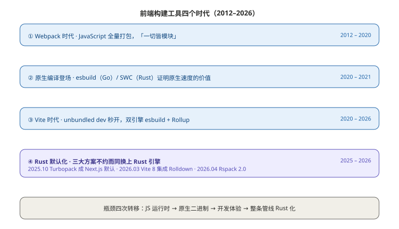
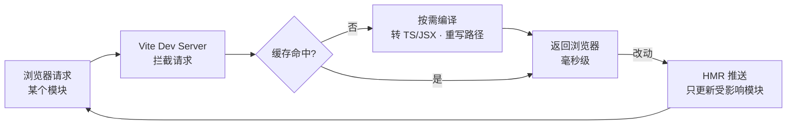
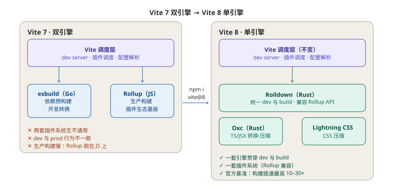
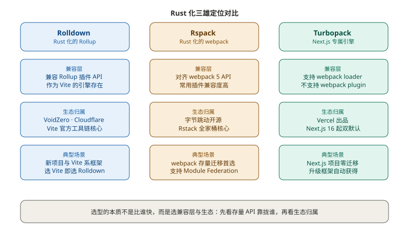
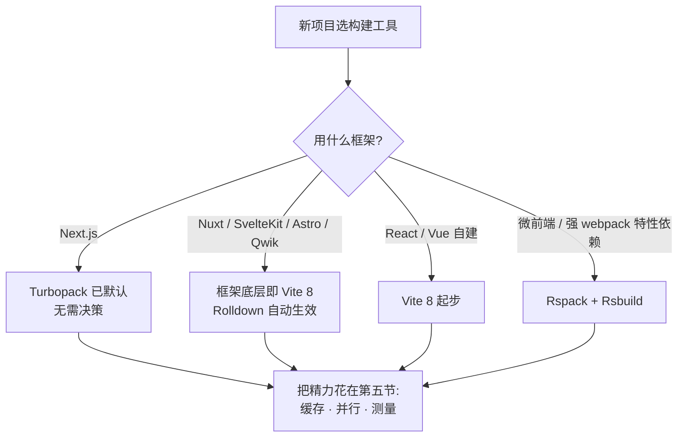

# 第二篇：构建工具演进——从 Webpack 到 Vite 再到 Rspack

**核心要点：**

- 演进主线四段：Webpack 用 JavaScript 把"bundle 一切"做到极致 → esbuild/SWC 证明原生速度的价值 → Vite 用 unbundled dev 重做开发体验 → Rolldown/Rspack/Turbopack 把整条构建管线搬进 Rust
- Vite 8（2026 年 3 月）用 Rolldown 收编双引擎：官方口径构建提速最高 10-30 倍，Linear 生产构建从 46 秒降到 6 秒，dev 与 prod 从此一套引擎、一种行为
- Rust 化三雄定位不同：Rolldown 兼容 Rollup API 服务 Vite 生态，Rspack 兼容 webpack API 服务存量项目，Turbopack 深度绑定 Next.js——选型的本质是选兼容层和生态
- webpack 没有死：5.111（2026 年 9 月）仍在活跃迭代，Module Federation 等能力仍是独门绝活，"还能用"和"最优"是两回事
- 换工具前先测量：Amdahl 定律会惩罚所有"听说快就去迁"的团队——打包只占 11% 时，打包快 3 倍整体也只省 0.7 秒
- 构建提速三板斧是通用解：持久化缓存、远程缓存与受影响构建、并行与按需编译，换工具只是其中一环

**这篇适合谁看：**

- 还在维护 webpack 项目，纠结"要不要迁、迁去哪、成本多大"的同学
- 天天用 Vite，但没搞清楚 esbuild 和 Rollup 各自在干什么的同学
- 需要为团队做 2026 年构建选型决策的技术负责人

## 一、开篇：构建工具为什么集体走向 Rust

第一篇说过，构建在前端流水线上出现两次：合并前验证"这次改动能不能构建"，合并后产出真正用于发布的制品。它是流水线上最重的一环——构建慢 30 秒，每个 PR、每次发布、每个开发者的每次热更新，都在为这 30 秒买单。

过去十几年，前端构建工具走过四个时代，而 2026 年恰好是收官之年，三个标志性事件在同一窗口发生：

- **2025 年 10 月**：Next.js 16 发布，Turbopack 成为开发与生产构建的**默认**打包器
- **2026 年 3 月**：Vite 8 发布，Rolldown 成为唯一打包引擎，官方称之为"自 Vite 2 以来最重要的架构变化"
- **2026 年 4 月**：Rspack 2.0 发布，这个 webpack 兼容的 Rust 打包器周下载量从 1.0 时代的 10 万涨到 500 万

把整条时间线画出来：

> 图注：四行从上到下是四代工具的主场期。最下面一行紫色是 2025–2026 年的关键转折——三大主流方案不约而同把 Rust 引擎设为默认，"要不要上 Rust"变成了"什么时候上"。

这篇文章帮你建立三个认知：

1. **每一代工具解决了什么问题，又留下了什么问题**——理解这个，才能理解 Rust 化为什么是必然
2. **三雄差异与选型逻辑**——同样是 Rust 打包器，兼容层和生态绑定完全不同
3. **存量项目迁移怎么评估**——用数据说话，而不是追热点

## 二、Webpack 时代：bundle 一切的功与过

### 1. "一切皆模块"：一个划时代的抽象

2012 年之前的前端没有"构建"这回事：HTML 里手写一串 `<script>`，依赖顺序靠人脑维护，全局变量满天飞。Webpack 给出了一个影响至今的核心抽象——**一切皆模块**：JS 是模块，CSS、图片、字体也都是模块，loader 把它们统一转换，webpack 沿着 `import` 语句递归出一棵完整的依赖图，最后打包成浏览器能跑的静态文件。

这个抽象的威力在于**把隐式依赖显式化**：资源之间的关系从"人肉约定"变成"代码声明"。配合强大的插件系统（loader 处理单文件转换，plugin 介入整个构建流程），webpack 成了十年间的事实标准，React、Vue 早期生态全部围绕它生长。

### 2. 瓶颈不是 bug，是架构

但 webpack 有个先天约束：它是用 JavaScript 写的，跑在 Node.js 的单线程事件循环里。三个后果：

- **冷启动即全量**：不管你改没改，启动 dev server 就要解析整棵依赖图。中型项目冷启动几十秒，大项目按分钟计
- **热更新也慢**：HMR 要在依赖图上做增量定位与重建，webpack 官方基准中典型热更新耗时 2.78 秒——你改一行 CSS，等近三秒才看到效果
- **并行化困难**：JS 单线程模型下，并行能力要靠 worker 和插件自己争取，收益有限

这些不是 webpack 团队的失误，而是语言与运行时的天花板。**当日构建、秒级反馈成为标配期待时，JavaScript 本身成了构建工具的瓶颈。**

### 3. 2026 年再看 webpack：它没有死

一个常见的误读是"webpack 已经被淘汰了"。事实是：截至 2026 年 9 月，webpack 5.x 仍在活跃迭代（最新版本 5.111），官方还在给主线添加新能力——增强内置的 CSS/TypeScript 支持、新的 universal target 等。

更重要的是存量：海量的老项目、深度定制过的构建配置、Module Federation 模版联邦，都还稳稳跑在 webpack 上。对这类项目，webpack 不是历史包袱，而是正在服役的基础设施。

正确的认知是：**webpack 依然是可用的选项，但不再是新项目的默认答案**。"还能用"和"最优"是两回事——这个区别，正是后文迁移评估的核心。

## 三、Vite：换一个思路做开发体验

### 1. unbundled dev：把打包从启动路径上拿掉

2020 年 Vite 2 发布，带来一个釜底抽薪的思路：**开发阶段干脆不打包**。

现代浏览器原生支持 ES Module，`import` 语句本身就是网络请求。Vite 的 dev server 只需要做一件事：拦截这些请求，按需编译单个模块，即刻返回。启动时间从"全量打包完毕"变成"起一个静态服务器"——秒开。

只有 `node_modules` 里的第三方依赖例外：它们是 CommonJS 格式、模块数量庞大，需要在启动时用 esbuild 预构建成少量 ESM 文件，这一步快到可以忽略。完整流程：

> 图注：与 webpack"先构建全图再启动"相反，Vite 把编译推迟到浏览器真正请求的那一刻，且只编译这一个模块。热更新同理，只处理受影响的子图。

这套架构让"改代码到看到效果"的反馈环从秒级降到毫秒级，Vite 迅速成为新项目首选：2026 年 3 月 Vite 8 发布时，官方公布其周下载量已达 6500 万次。

### 2. 双引擎的裂缝

但为了兼顾速度与生态，Vite 早期做了一个务实的选择：**双引擎**——开发阶段用 esbuild 求快，生产构建用 Rollup 求稳（Rollup 的插件 API 撑起了整个 Vite 插件生态）。

这个选择服务了 Vite 五年，代价也在累积。Vite 官方在 Vite 8 公告中明确承认了三条：

- **两套插件系统**：esbuild 和 Rollup 的插件互不通用，Vite 团队要维护大量"胶水代码"让两边行为对齐
- **dev 与 prod 行为不一致**：两个引擎对模块解析、循环依赖、tree-shaking 的处理各有细微差异——开发时好好的，构建完出问题，是 Vite 项目最经典的疑难杂症
- **生产构建慢**：Rollup 是用 JavaScript 写的，大项目生产构建动辄几十秒，与 dev 的"秒开"形成落差

裂缝的根源和 webpack 一样：**只要构建链路上还有 JavaScript 引擎，就有它够不着的那段速度**。

### 3. Vite 8：Rolldown 收编双引擎

2026 年 3 月 12 日发布的 Vite 8 给出了终局方案：**Rolldown**——Vite 团队用 Rust 从零写的打包器，对外提供 Rollup 兼容的插件 API。dev 的依赖预构建和生产构建统一交给它，JavaScript 转换与压缩交给同源的 Oxc 工具链，CSS 压缩默认交给 Lightning CSS。整条热路径全部 Rust 化。

> 图注：左面板的红字是双引擎的历史债务；右侧的绿色代表 Rust 原生部件——Vite 调度层不变，底下从两个引擎变成一组 Rust 工具。箭头就是一次 `npm i vite@8`。

效果用官方和真实案例说话：

| 案例 | Vite 8 构建提速（官方口径） |
| --- | --- |
| Linear | 生产构建 **46 秒 → 6 秒** |
| Beehiiv | 构建耗时 **-64%** |
| Ramp | 构建耗时 **-57%** |
| Mercedes-Benz.io | 构建耗时 **-38%** |
| 官方基准 | 对比 Rollup 最高 **10-30 倍** |

迁移成本被刻意压到了最低：官方提供兼容层，自动转换绝大多数 esbuild/Rollup 配置，很多项目升级只需改一个版本号；`rollupOptions` 更名为 `rolldownOptions`（旧名暂时保留但提示弃用）。需要留意的成本有三点：要求 Node.js 20.19+/22.12+；原生二进制让安装体积增加约 15MB；个别默认行为有变化——比如 CommonJS 模块的默认导出解析规则变了，而且**不报错、静默变化**，升级后要跑一遍核心回归。

对大型项目，Vite 7 时代还有一条渐进路径：把 `vite` 包别名到 `rolldown-vite`，先换引擎再升版本，两步分开验证。Vite 8 稳定后，这条过渡路径的使命基本完成，直升即可。

生态层面还有两个标志性事件值得记录：2026 年 6 月，Cloudflare 收购了 Vite 母公司 VoidZero（Evan You 创立），承诺工具链保持开源中立并设立 100 万美元生态基金；2026 年 9 月，Vite+ 1.0 发布，把 Vite 8、Vitest、Oxlint、Oxfmt、Rolldown 打包成一套统一工具链。**构建工具的竞争，正在从"单个工具比快"变成"整套工具链比全"。**

## 四、Rust 化三雄：Rolldown、Rspack、Turbopack

### 1. 同一波浪潮，三种答案

Rolldown、Rspack、Turbopack 常被放在一起比较，但它们其实是对同一个问题的三种回答。相同的是底层：Rust 并行编译、增量计算、原生性能；不同的是**兼容了哪套 API、绑定哪个生态**。

> 图注：看三行关键差异——兼容层（Rollup API / webpack API / 仅 loader）、生态归属（VoidZero+Cloudflare / 字节 Rstack / Vercel）和典型场景。三列颜色只区分阵营，不含好坏。

- **Rolldown**：Rust 化的 Rollup。它不直接面向终端开发者，而是作为 Vite 的引擎存在。你选 Vite，就等于选了 Rolldown
- **Rspack**：Rust 化的 webpack。API 与配置对齐 webpack 5，常用插件兼容度高，支持 Module Federation；字节跳动出品，配套 Rstack 全家桶（Rsbuild 构建、Rslib 打库、Rstest 测试、Rspress 文档站、Rsdoctor 分析、Rslint lint）
- **Turbopack**：Vercel 为 Next.js 定制的引擎。Next.js 16 起 dev 与 build 双默认，支持 webpack loader 但**不支持 webpack plugin**——它压根不打算做通用打包器，就是 Next.js 的专属引擎

### 2. 性能数据怎么看

先看 Rspack 官方在 1 万个 React 组件基准项目上的持续跟踪数据：

| 版本 | 生产构建（无缓存） | 缓存命中构建 | HMR 热更新 |
| --- | --- | --- | --- |
| Rspack 1.0（2024-08） | 5.6s | 5.6s | 128ms |
| Rspack 1.7 | 3.6s | 2.2s | 134ms |
| Rspack 2.0（2026-04） | 3.1s | 1.4s | 118ms |

对照同一场景量级的 webpack：官方基准中生产构建 28.1 秒、冷启动 dev 21.4 秒、HMR 2.78 秒——**十倍级别的差距**，这正是 Rspack 立项时"10 倍性能、兼容 webpack"目标的兑现。Rspack 2.0 还有两项容易被忽视的工程改进：核心包转为纯 ESM、默认依赖断崖式精简（`@rspack/dev-server` 的依赖从 192 个砍到 1 个，安装体积从 15MB 降到 1.4MB），到 2026 年 8 月已迭代到 2.2。

Turbopack 的官方口径是：对比 webpack，Fast Refresh 提速 5-10 倍、生产构建提速 2-5 倍。数字看起来比 Rspack 温和，但它是"无感默认"——Next.js 用户升级框架就自动获得，没有迁移动作，这本身就是一种策略：**最好的迁移是不迁移**。

怎么看这些数字，两条提醒：

- **官方基准都选了对自己有利的场景**，你的项目结构（依赖体积、loader 链、插件数量）决定了实际收益。基准只能证明"量级差距存在"，具体数字要在自己项目里实测
- **构建工具的收益大头来自"并行 + 缓存"两个词**，Rust 只是让这两件事的实现上限高了一个数量级

### 3. 一张表收拢选型

| 你的现状 | 更优解 | 理由 |
| --- | --- | --- |
| Next.js 项目（13 以上） | Turbopack（自动获得） | 框架默认，零迁移动作 |
| Nuxt / SvelteKit / Astro 等 Vite 系框架 | 升级框架即得 Vite 8 | 框架底层已切 Rolldown |
| 自建 Vite 的 React/Vue 项目 | 升级 Vite 8 | 兼容层兜底，成本最低的 Rust 化路径 |
| webpack 存量，插件多、Module Federation | Rspack | webpack API 兼容，迁移成本最低 |
| webpack 存量，配置简单、插件少 | Vite 8 或 Rspack | 两者皆可，按迁移面评估（见第六节） |
| 深度依赖 webpack 独有插件，且运行稳定 | 留在 webpack | 5.111 仍在迭代，没有强制下车的理由 |

## 五、光换工具还不够：构建提速的工程手段

换工具是构建提速最"爽"的一招，但它是手段之一，不是全部。这一节把工程手段凑齐，它们和工具选择正交，可以叠加。

### 1. 持久化缓存：第二次构建快一半以上

Rust 引擎的冷启动很快，但**第二次构建本不该是冷启动**。Rspack 内置持久化缓存：模块转换结果按输入指纹落盘，上表里 3.1 秒 → 1.4 秒的差距就是它。Vite/Rolldown 同样支持持久缓存。工程上的要点只有一个：**在 CI 里把缓存目录持久化**——把缓存目录（如 `node_modules/.cache`）加入 CI 缓存配置，配合第一篇说的 80% 缓存命中率水位，流水线里大部分构建都能吃到。

### 2. 远程缓存与受影响构建

Monorepo 场景的两件套：Turborepo 和 Nx 的远程缓存让"任何人构建过的产物，全团队的 CI 直接复用"；受影响构建（affected）让"改了哪个包，只构建依赖它的应用"。两者叠加，大型 Monorepo 的 CI 提速动辄 5-10 倍。这套玩法和打包器无关，属于流水线层的优化，第四篇讲 Monorepo 时展开。

### 3. 并行与按需

两个朴素的动作：CI 里把 Lint、类型检查、构建拆成并行任务，总时长约等于最慢的一个而不是三个相加；开发环境开启按需编译（lazy compilation），没访问到的页面不参与构建。另外别忘了给 Rust 引擎"让路"——把还在用 babel-loader 的链路换成内置转换（如 Rspack 的 `builtin:swc-loader`），否则一个 JS 写的 loader 就能把整条 Rust 流水线拖回解放前。

### 4. Amdahl 定律：先测量，再动手

最重要的一个工程认知，用一个真实案例讲：有开发者（Chris Boakes）给小站点实测 Vite 8，打包环节确实快了 3.2 倍——但整体构建时间只快了 0.7 秒。原因很简单：**打包只占整体构建的 11%**。

这就是 Amdahl 定律：整体提速受限于没被提速的部分。你把占比 11% 的环节加速 3 倍，整体也只能快 7% 左右。反过来推论：迁移前先 profile 一次构建，把耗时拆开看——大头可能是依赖安装、类型检查、图片压缩、测试，而不是打包。**如果打包根本不是大头，换再快的打包器也救不了你的流水线。**

所以正确的顺序永远是：测量 → 找大头 → 对症下药。换工具只是"对症"的其中一种药。

## 六、选型决策：新项目与存量项目两条路

### 1. 新项目：跟着框架走

2026 年做新项目选型，比五年前简单得多——因为框架已经替你做了大部分决定：

> 图注：决策树最终都汇到同一个节点——工具选定后，构建提速的大头在工程手段，不在工具本身。

原则一句话：**新项目跟着框架生态走，不要自建 webpack**。除非你明确需要 Module Federation 这类 webpack 血统的能力，否则自建 webpack 是给自己埋存量包袱。

### 2. 存量项目：三步评估法

存量项目迁移最忌讳"听说快就去迁"。一套可复用的三步法：

**第一步：测量**。给现有构建做一次 profile，把耗时拆成依赖安装、转换、打包、压缩、其他，算清楚"打包占比"。回到 Amdahl 定律：占比不够大，收益天花板就低，这个项目可能根本不值得迁。

**第二步：评估兼容面**。盘点项目里的自定义 plugin、loader、构建钩子，逐个对照目标工具的兼容清单。webpack → Rspack 有一条成熟的迁移指南，大部分配置同名同义；Vite → Vite 8 有官方兼容层。真正花时间的是长尾插件和静默的行为差异（如 CJS 互操作），不是主干配置。

**第三步：验证**。拉分支做对照实验：同一项目分别用新旧工具构建，对比四个数字——构建总时长、HMR 时延、产物体积（注意 chunk 划分变化对缓存的影响）、核心页面回归结果。收益和成本都用数据落账。

最后算总账：**迁移收益 = 时间节省 × 触发频率 − 迁移成本 − 风险成本**。CI 每天跑几十次的场景，节省 20 秒也值得；一年构建几次的工具库，快 10 倍也未必值得动手。

### 3. 迁移检查清单

| 检查项 | webpack → Rspack | Vite 6/7 → Vite 8 |
| --- | --- | --- |
| Node 版本 | ≥ 20.19 或 ≥ 22.12 | ≥ 20.19 或 ≥ 22.12 |
| 配置文件 | `webpack.config` → `rspack.config`，字段大多同名 | 兼容层自动转换，`rollupOptions` 改名 `rolldownOptions` |
| 插件 | 常用插件兼容度高，逐一核对兼容清单 | Rollup 插件兼容，个别需要适配 |
| loader | babel-loader 建议换成内置 `builtin:swc-loader` | esbuild 选项自动映射到 Oxc |
| 行为差异 | 个别默认值差异，跑回归确认 | CJS 默认导出解析规则变化（**静默，重点测**） |
| 安装体积 | 2.0 起依赖大幅精简 | 原生二进制约 +15MB |
| 验证动作 | 对照构建四个指标 + 核心页面回归 | 同左，另加 CJS 依赖专项检查 |

## 七、总结

把整篇文章收拢成几句话：

- **演进主线是四次瓶颈转移**：JavaScript 运行时太慢（webpack）→ 原生二进制破局（esbuild/SWC）→ dev 体验用 unbundled 重做（Vite）→ Rust 把 dev 与 prod 的整条管线统一（Rolldown/Rspack/Turbopack）。每一次都是上一代的红利吃尽后，瓶颈逼出来的架构换代
- **Vite 8 是 2026 年最大的架构事件**：双引擎合为 Rolldown 单引擎，dev/prod 一致性问题被连根拔起，构建提速最高 10-30 倍，而升级成本被兼容层压到一个版本号
- **三雄选配置看兼容层**：Rollup API → Rolldown（Vite 生态），webpack API → Rspack（存量迁移），Next.js → Turbopack（零迁移默认）
- **webpack 仍是合理选项**：5.111 活跃迭代中，存量项目"还能用"，但没有新项目再选它做默认
- **工程手段和工具选择正交**：持久化缓存、远程缓存与受影响构建、并行与按需，任何工具下都成立；Amdahl 定律提醒你——先测量打包占比，再决定换不换工具
- **迁移是笔账**：收益 = 时间节省 × 频率 − 迁移成本 − 风险成本，三步法（测量 → 评估兼容面 → 对照验证）让每个数字有出处

工具选好了，下一个问题是：团队里第 N 个新项目从哪来？如果每个项目都靠"拷一个老项目改改名"，规范和构建配置会迅速飘移。下一篇《脚手架与项目模板——标准化研发的起点》讲清楚：模板仓库、CLI 生成器、平台化创建向导三个层次怎么搭，模板如何治理才不会腐化，以及 AI 时代"模板即规范"的新玩法。
