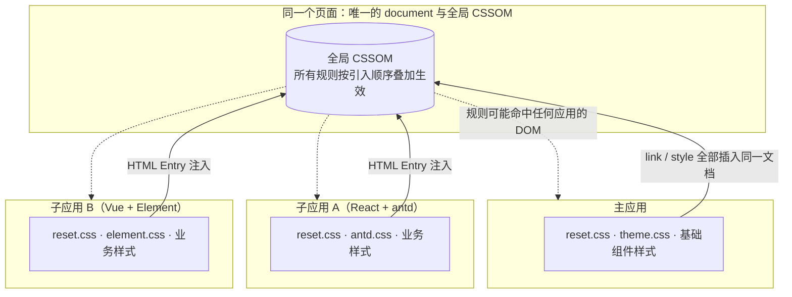
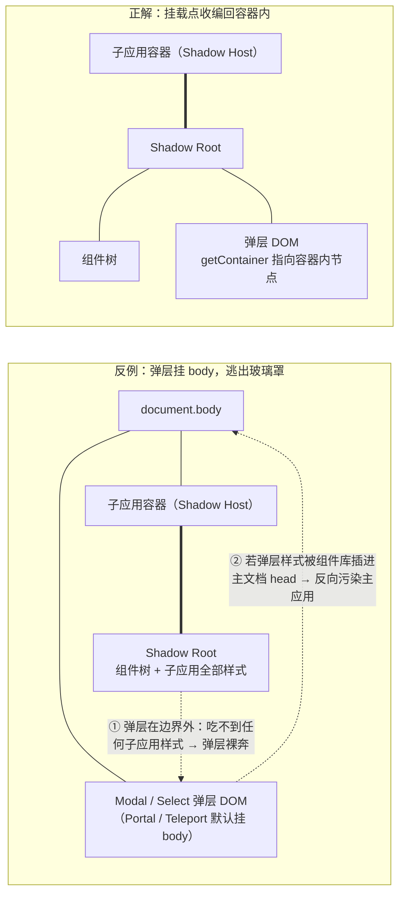
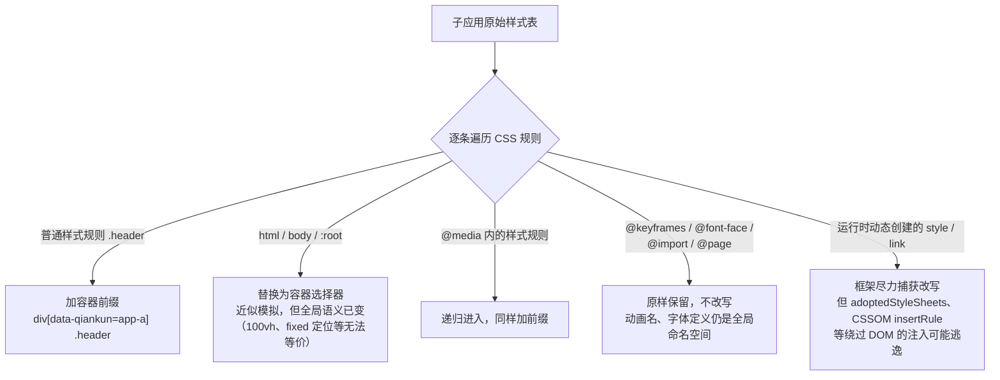
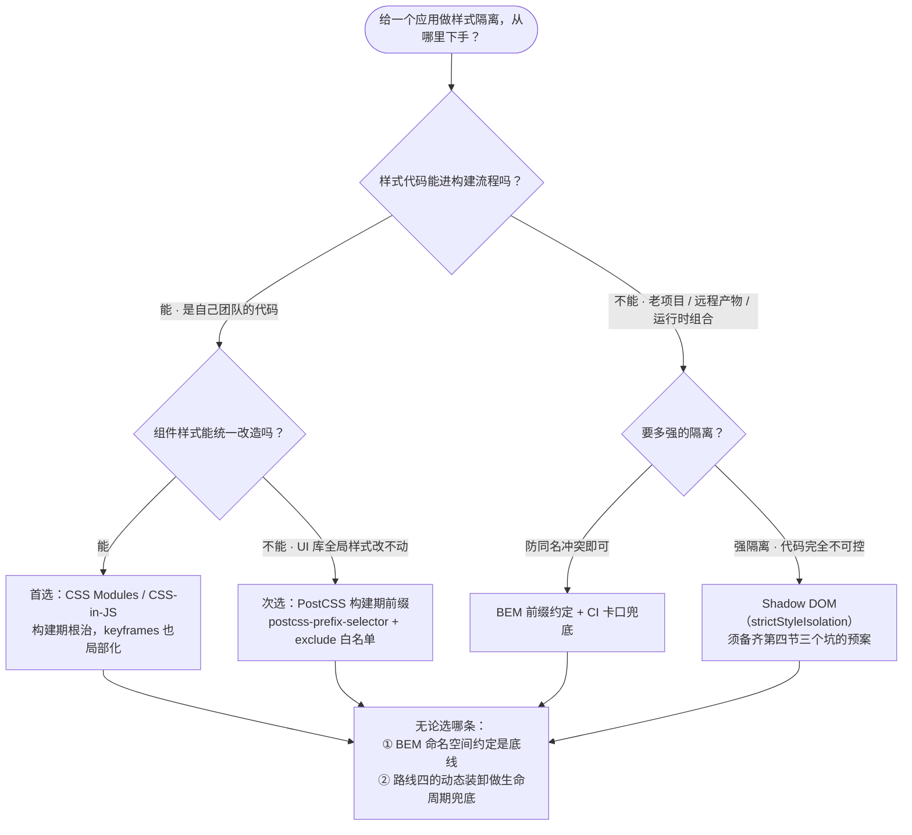
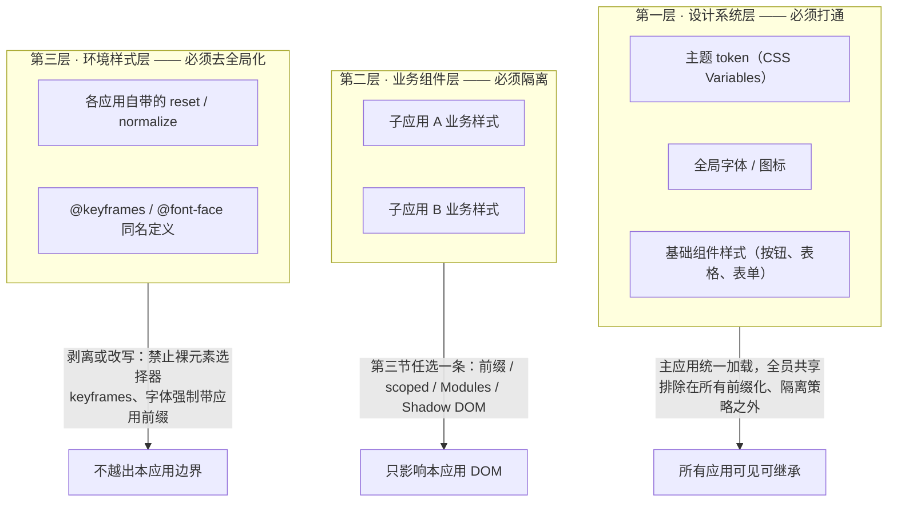
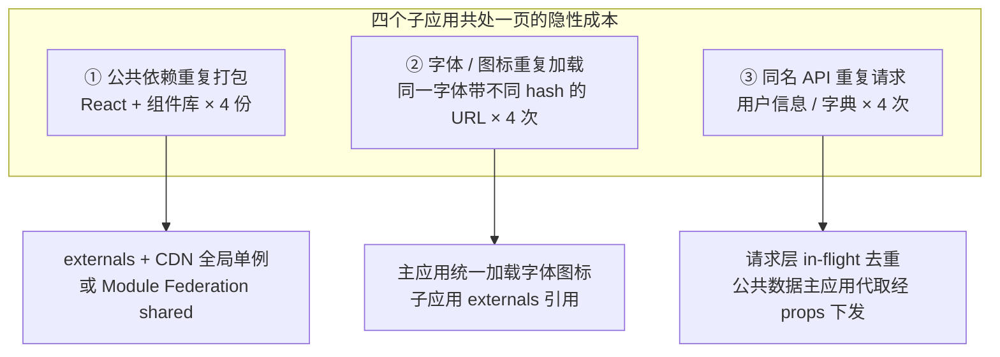
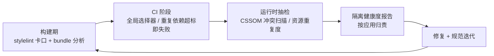

# 第九篇：样式隔离与资源管理

**核心要点：**

- 样式冲突的根因：多个应用共享同一个 document 的 CSSOM，全局选择器、同名 class、CSS Variables、keyframes 互相覆盖
- qiankun 的两种隔离回顾与局限：strictStyleIsolation（Shadow DOM，天然隔离但弹层挂 body 会逃逸）与 experimentalStyleIsolation（运行时 scoped 转换，覆盖面有限）——本篇聚焦「机制之外怎么落地」
- 主流落地路线排序：BEM/命名约定（成本最低、靠纪律）、PostCSS 构建期前缀（postcss-prefix-selector 自动化）、CSS Modules/CSS-in-JS（构建期根治）、动态装卸子应用样式表（切换时增删 link/style）
- Shadow DOM 的实战坑：弹层挂 body 逃逸隔离、全局字体与 reset 无法穿透、事件委托与 a11y 的边界问题
- 资源管理的三个重复：字体/图标库重复加载、公共依赖（React/Vue/组件库）重复打包的体积膨胀、同名 API 请求重复发起——分别用 shared/externals、CDN 收敛、请求层去重处理
- 隔离策略要「分级」：设计系统层（主题 token、基础组件）应该打通共享，业务样式应该严格隔离——全隔离或全共享都是错的
- 度量闭环：用自动化检测（样式覆盖率、资源重复度扫描）验证隔离效果，而不是靠肉眼 review

> 本文是「微前端架构」技术专栏的第九篇。上一篇文章的结尾留了一个问题：为什么两个应用的按钮颜色会互相覆盖、子应用的字体为什么会影响主应用。机制层面——qiankun 的 `strictStyleIsolation` 与 `experimentalStyleIsolation` 两个开关——在第 4 篇 §5 已经拆过；这一篇聚焦「开关之外」的工程落地：冲突的根因、四条落地路线、Shadow DOM 的实战坑、设计系统的分级共享，以及同样容易被低估的资源管理，最后用自动化度量把一切收口。

## 一、开篇：样式没有沙箱

先建立一个认知：**微前端体系里，JS 有沙箱，样式没有。**

JS 的隔离有一整套基础设施：快照沙箱、Proxy 代理沙箱（第 4 篇 §4），甚至 iframe 的进程级硬隔离（番外篇一）。但样式没有与之对等的原生机制——只要所有应用渲染在同一个 document 里，它们的样式就必然涌向同一个 CSSOM。浏览器不会因为「这条规则是子应用 A 写的」就给它划定作用域。

把这件事画出来：



> 图注：三个应用各自的样式文件，最终都汇入**同一个** CSSOM。虚线箭头是关键——CSSOM 里的每条规则，默认都能命中页面上任何应用的 DOM，包括「别人家的」。

这不是 qiankun 或某个框架的缺陷，而是浏览器渲染模型的现实：**CSS 的作用域单位是 document，不是应用。** 微前端打破了这个单位，于是所有「单体时代不存在」的冲突都冒了出来。

### 1.1 样式冲突的四种形态

把冲突按「怎么发生」分四类，后面所有方案都是在逐类应对：

| 冲突类型 | 典型例子 | 症状 | 特点 |
| :--- | :--- | :--- | :--- |
| 全局选择器 | 子应用的 `button {}`、`* { box-sizing }`、`body { font-size: 14px }` | 全页面按钮变透明、主应用字号被改 | 裸元素/通配选择器命中所有 DOM，杀伤半径最大 |
| 同名 class | 两个子应用都有 `.header`、`.list`、`.active` | 后加载的应用样式覆盖先加载的 | 谁后插入谁生效，冲突随加载顺序漂移，极难复现 |
| CSS Variables | 两个应用都在 `:root` 定义 `--primary-color` | 主题色「随机」变化 | 变量定义在 `:root` 上就是全局变量，后者覆盖前者 |
| @keyframes / @font-face | 两个应用都定义 `@keyframes spin` 或 `Inter` 字体 | 动画「抽搐」、字体加载后突然变化 | 这两类规则的名字在 CSS 里是全局命名空间，同名直接互相覆盖 |

一个真实的冲突现场：子应用 A 带了一份「业界标配」的 reset.css——

```css
/* 子应用 A 的 reset.css，单体时代人人都在用 */
button {
  background: transparent;
  border: none;
  padding: 0;
  font: inherit;
}

body {
  font-size: 14px;
}
```

这段样式一旦被 HTML Entry 注入页面（第 4 篇 §6），`button` 规则命中**全页面所有按钮**——包括主应用导航栏和其它子应用的。主应用明明什么都没改，按钮却「自己变样了」。这就是全局选择器的杀伤半径。

### 1.2 为什么样式污染比 JS 报错更难缠

第 4 篇 §5 开头说过样式污染是「慢性问题」，这里把「慢性」拆成三个具体的难缠点：

1. **静默**。JS 冲突会抛异常，样式冲突不报错——只是「看起来不对」。Console 干干净净，用户却看到了错的界面。
2. **延迟**。今天只接了子应用 A，一切正常；两周后接了 B，A 的页面「自己坏了」。冲突发生的时间和原因在时间上分离，排查窗口极长。
3. **跨界归责**。DevTools 的 Styles 面板只能告诉你「现在谁生效了」，不能告诉你「这条规则本不该生效」。到底是 A 污染了 B，还是 B 覆盖了 A？没有归属标记，就是一锅粥。

这三个特点决定了本篇的基调：**样式隔离不能靠「出了问题再修」，必须靠工程手段提前收口，并且要能被机器验证**（第七节）。

## 二、框架给了什么：两个开关的能力边界

在讲落地之前，先把第 4 篇 §5 的机制快速捡回来，重点补上「实战中它们到底挡不住什么」。

### 2.1 默认行为：只管「装卸」，不管「隔离」（qiankun 2.x 语境）

qiankun 2.x 默认**不开启**样式隔离。它默认做的是样式资源的生命周期管理：HTML Entry 解析出子应用的 `<link>`/`<style>`，挂载时插入、卸载时移除（第 4 篇 §5.1）。

这解决的是「子应用切出后样式不残留」，是**资源管理**（本篇第六节的路线四），不是**隔离**。主应用与子应用之间、多实例场景下子应用之间的样式冲突，默认完全裸奔。

### 2.2 strictStyleIsolation：罩得住组件树，罩不住弹层（qiankun 2.x 语境）

`strictStyleIsolation: true` 把子应用容器变成 Shadow DOM，子应用的所有 DOM 和样式都收进 Shadow Root——外部样式渗不进来，内部样式漏不出去（第 4 篇 §5.2）。

机制本身是浏览器原生的，隔离强度确实高。但「玻璃罩」有一个结构性盲区：**它只能罩住容器内部的 DOM，而现代组件库的弹层默认不渲染在容器内部。**



> 图注：左图是默认行为的两处泄漏——①弹层 DOM 挂在 body 上，位于 Shadow 边界之外，Shadow Root 里再全的样式它也吃不到，于是弹层「裸奔」；②组件库往往在运行时把弹层样式插进 `document.head`，这些全局规则反过来污染主应用。右图是修复方向：把弹层挂载点收编回容器内部（4.1 节给出具体写法）。

除此之外还有一层「反直觉失效」：子应用习惯把全局样式写在 `html`/`body`/`:root` 上，而 Shadow Root 里**根本没有这些元素**——子应用的全局字体、rem 基准、body 级 reset 会集体失效，表现为「开了严格隔离，子应用布局反而漂了」。这正是 4.2 节的主角。

### 2.3 experimentalStyleIsolation：scoped 改写的覆盖面（qiankun 2.x 语境）

`experimentalStyleIsolation: true` 走的是另一条路：运行时把子应用的样式规则逐条改写，加上容器前缀（第 4 篇 §5.3 的 `.header → div[data-qiankun="app-a"] .header`）。

它更像一个「运行时的 scoped 转换器」。理解它的最好方式，是看清它对每一种 CSS 规则的处理边界：



> 图注：只有普通样式规则和 @media 内的规则会被完整改写；`html`/`body`/`:root` 会被替换成容器选择器做近似模拟；@keyframes、@font-face 这些「全局命名空间」规则原样放行——两个子应用都定义 `@keyframes spin`，后加载的覆盖先加载的，动画就「抽搐」了。

也就是说，这个开关挡得住**类名冲突**，挡不住**全局选择器的间接泄漏**（改写后虽然挂上前缀，但改写前的规则顺序、特异性竞争依然存在）、挡不住**keyframes/字体撞名**、对**动态注入**也只有尽力而为。

### 2.4 开关是机制，落地靠组合拳

两个开关的边界看清之后，结论自然浮现：

**框架提供的隔离开关只是「机制」，不是「方案」。** 真实的生产项目里，隔离从来不是一个开关解决的事，而是几条工程手段的组合：命名约定、构建期改写、组件级作用域、样式表生命周期管理，外加对 Shadow DOM 坑位的预案。这正是第三节的主题。

## 三、四条落地路线

按「接入成本从低到高、根治程度从弱到强」排序，主流落地路线有四条。它们不是互斥选项，而是可以叠加的层次——先看各条路线本身。

### 3.1 路线一：BEM/命名约定——成本最低，靠纪律

最朴素的方案：每个应用声明一个命名空间，所有 class 挂上自己的前缀。

配套示例（examples/micro-frontend/qiankun-basic-demo）里就是这么做的：order 子应用全部用 `order-` 前缀，dashboard 子应用全部用 `dashboard-` 前缀，两者彼此错开——

```css
/* 子应用 order：所有 class 带 order- 前缀 */
.order-app { min-height: 520px; }
.order-button { background: #ea580c; }
.order-button.secondary { background: #e2e8f0; }

/* 子应用 dashboard：全部用 dashboard- 前缀，井水不犯河水 */
.dashboard-card { box-shadow: 0 18px 40px rgba(15, 23, 42, 0.07); }
```

把约定写完整，应该覆盖三类「全局命名」的东西：

1. **class**：应用级前缀（`order-`）+ 组件级前缀（BEM 的 `order-button__icon--disabled`）
2. **@keyframes**：`@keyframes order-spin`——否则动画撞名依然互相覆盖
3. **CSS Variables**：业务变量挂前缀 `--order-gap`；公共设计 token 反过来由主应用统一定义（第五节）

它的优势是**零构建成本、零运行时成本、任何框架通用**；劣势是**纯靠纪律**——第三方的 antd.css、element.css 不会自觉加前缀，新同事也可能随手写一个裸 `.title`。所以命名约定必须配一条 CI 卡口（7.1 节），否则半年必破。

### 3.2 路线二：PostCSS 构建期前缀——把纪律自动化

既然手工前缀靠纪律，那就让构建工具代劳。`postcss-prefix-selector` 可以在构建期给每条选择器自动加作用域前缀，效果等价于 qiankun 的 `experimentalStyleIsolation`，但发生在**构建期**——零运行时开销，产物天然自带隔离：

```js
// 子应用的 postcss.config.js —— webpack（postcss-loader）与 Vite 都会自动读取
const postcssPrefixSelector = require('postcss-prefix-selector');

module.exports = {
  plugins: [
    postcssPrefixSelector({
      // 前缀改写成属性选择器，与 qiankun 的容器选择器风格一致
      transform(prefix) {
        return `[data-app="order"] ${prefix}`;
      },
      // 设计系统共享层、第三方主题要排除——它们本来就该全局生效
      exclude: [/\.design-system/, /theme-shared/],
    }),
  ],
};
```

配套约定：子应用根节点挂上 `data-app="order"`（这一步也可以由主应用在挂载容器时统一做）。转换前后的对比：

```css
/* 转换前 */                    /* 转换后 */
.order-app { ... }              [data-app="order"] .order-app { ... }
.order-button { ... }           [data-app="order"] .order-button { ... }
```

两个使用要点：

1. **exclude 清单是这个方案的关键**。它正是第五节「分级隔离」的技术载体：设计系统层要共享的样式放进 exclude，业务样式一律加前缀。exclude 靠白名单管理，改动要过评审。
2. 它解决的是**选择器泄漏**，和 experimentalStyleIsolation 一样管不了 @keyframes、@font-face 撞名——所以它是在路线一的纪律之上「自动化」，不是替代品。

### 3.3 路线三：CSS Modules / CSS-in-JS——构建期根治

如果组件样式本身就是你团队的代码，最彻底的方案是在**组件层面**就消灭全局样式：CSS Modules 在构建期把类名编译成带哈希的唯一名字，CSS-in-JS 在运行时生成带内容哈希的类名。撞名在物理上不可能发生：

```js
/* Button.module.css —— 源码里类名只在文件内有效 */
.button { background: var(--brand-primary); }
.danger { background: var(--brand-danger); }
```

```css
/* 构建产物：类名被编译成「文件名 + 局部类名 + 哈希」，
   两个子应用各自有一份 .Button-module__button__xxx，永不撞名 */
.Button-module__button__2Kf9x { background: var(--brand-primary); }
```

```js
// 组件里 import styles from './Button.module.css';
<button className={styles.danger}>删除</button>
```

它比路线二多解决一类问题：**CSS Modules 会连 @keyframes 一起局部化**——模块内定义的 `spin` 会被重命名为 `文件名_spin__hash`，`animation: spin` 的引用同步改写，动画撞名这个死角被根治。

工程约束有三条：

1. **全局样式入口必须收口**。每个应用只保留一个 `global.css`（或 CSS-in-JS 的 createGlobalStyle），并且只允许写设计系统层内容；业务组件禁止写裸全局规则。
2. **CSS-in-JS 要注意样式注入位置**。默认插进 `document.head`，挂载点应指回子应用容器，避免卸载后残留（与路线四配合）。styled-components 的 `StyleSheetManager`、emotion 的 `CacheProvider` 都支持自定义 container。
3. **老代码迁移是主要成本**。适合在「新子应用一律 CSS Modules，老子应用加前缀」的双轨制下渐进推进。

第 6 篇讲 Module Federation 时提过：MF 没有任何运行时隔离，样式全靠「CSS Modules / 命名前缀约束」——说的就是这条路线。

### 3.4 路线四：动态装卸样式表——管好样式的生命周期

前三条路线解决「规则互相打架」，第四条解决「规则的生死时机」：**子应用激活时插入样式表，卸载时移除**。

qiankun 的 HTML Entry 默认已经做了这件事（2.1 节）。需要自己动手的是另外两类场景：Module Federation 的模块级组合、以及任何没有框架托管的手工集成：

```js
// 手工管理子应用样式表：加载与卸载严格成对（呼应第 8 篇 §3.4 的对称原则）
const loadedSheets = new Map(); // appName -> HTMLLinkElement[]

export async function loadStyles(appName, urls) {
  const links = await Promise.all(
    urls.map(
      (url) =>
        new Promise((resolve, reject) => {
          const link = document.createElement('link');
          link.rel = 'stylesheet';
          link.dataset.app = appName; // 归属标记：卸载与运行时扫描都靠它
          link.onload = () => resolve(link);
          link.onerror = reject;
          link.href = url;
          document.head.appendChild(link);
        }),
    ),
  );
  loadedSheets.set(appName, links);
}

export function unloadStyles(appName) {
  (loadedSheets.get(appName) ?? []).forEach((link) => link.remove());
  loadedSheets.delete(appName);
}
```

两个工程细节：

1. **`dataset.app` 这个归属标记值得统一成规范**。它同时服务于卸载清理（本节）和运行时冲突扫描（7.2 节）——「每条样式知道自己属于谁」，是后面所有度量手段的地基。
2. **卸载要防过渡态闪烁**。子应用切出瞬间先卸样式再卸 DOM，会出现一帧「裸 DOM」；先卸 DOM、再卸样式（或在新应用样式就绪后再卸旧的）能避免闪烁。

### 3.5 四条路线怎么组合

四条路线的分工其实是正交的：前三条解决「选择器作用域」，第四条解决「生命周期」。选型的决策路径如下：



> 图注：决策树只回答「从哪条下手」——能进构建流程的优先构建期方案（路线三 > 路线二），进不了的按隔离强度在路线一和 Shadow DOM 之间选。四条路线最终都汇入同一条底线：命名约定 + 动态装卸兜底。各路线的盲区对照下表逐项核查。

| 路线 | 隔离强度 | 接入成本 | 主要盲区 | 典型适用 |
| :--- | :--- | :--- | :--- | :--- |
| BEM/命名约定 | 中（防撞名） | 最低（纯规范） | 防不住裸元素选择器、第三方库样式 | 所有应用的底线层 |
| PostCSS 构建期前缀 | 中高（选择器级） | 低（一份构建配置） | keyframes/字体撞名、需维护 exclude 白名单 | 老项目、UI 库样式改不动的应用 |
| CSS Modules / CSS-in-JS | 高（构建期根治） | 中（组件改造量） | 全局样式入口需要收口 | 新子应用、同栈团队的首选 |
| 动态装卸样式表 | 无（管生命周期） | 低（框架已托管） | 不解决冲突，只解决残留 | 手工集成、MF 场景的必备兜底 |
| Shadow DOM（严格隔离） | 最高（原生边界） | 高 | 第四节的三个坑 | 强隔离诉求、代码完全不可控 |

## 四、Shadow DOM 实战：三个绕不开的坑

第二节预告了 Shadow DOM 的结构性盲区，这一节把三个坑逐个拆开。先说清一个前提：**这些坑不意味着 Shadow DOM 不可用，而是意味着它有一份明确的「使用预案」**——不想付这份预案的成本，就退回第三节的工程路线。

### 4.1 坑一：弹层挂 body，逃出玻璃罩

**现象**：开启 `strictStyleIsolation` 后，Modal、Select 下拉、Tooltip 全部「裸奔」——能弹出来，但没有任何样式；或者组件库运行时把弹层样式插进 `document.head`，主应用页面突然多了几条不属于自己的规则。

**根因**：React 的 Portal、Vue 的 Teleport、各大组件库的弹层，默认挂载点都是 `document.body`。Shadow DOM 的边界只罩住容器内部，挂在 body 上的弹层既吃不到 Shadow Root 里的样式，还会把组件库动态插入的样式漏到主文档——就是 2.2 节图里那两条虚线。

**解法：把弹层挂载点收编回容器内部。** 各技术栈的写法：

```js
// antd：Select/Tooltip 用 getPopupContainer，Modal 用 getContainer
// 原则：挂载点指向子应用容器内的节点，而不是 body
<Select
  getPopupContainer={(triggerNode) => triggerNode.parentElement}
/>
<Modal getContainer={(node) => node.parentElement} />
```

```js
// Element Plus：全局关闭 teleport，或逐个组件指定 append-to
app.use(ElementPlus, { config: { teleported: false } });
```

```html
<!-- Vue3：Teleport 的目标改为子应用容器内的节点 -->
<Teleport to="#order-app-root">
  <div class="order-modal">...</div>
</Teleport>
```

收编之后有两个连带问题要处理：

1. **层叠上下文**：弹层从 body 挪进容器后，不再天然拥有最高的 z-index 空间，可能被主应用导航遮挡——给容器内的弹层根节点规划好 z-index 层级。
2. **裁剪**：容器链上任何一个祖先有 `overflow: hidden`，下拉就会被裁掉——收编时顺手检查容器链的 overflow。

### 4.2 坑二：全局字体与 reset 集体失效

**现象**：开了严格隔离，子应用字体不对、间距漂移、rem 尺寸全乱。

**根因**：子应用的全局样式都写在 `html`/`body`/`:root` 上，而 Shadow Root 里没有这些元素——**这些选择器选不到任何东西**，整个「全局层」静默失效。有意思的是继承依然工作：主应用 `body` 上的 `font-family` 作为可继承属性，会穿过 Shadow Host 进到 Shadow 树里——所以症状往往是「主应用的字体渗进来了，子应用的字体却没了」。

**解法**：把子应用的「全局层」改挂在两个合法入口上——

```css
/* Shadow Root 内部：全局样式改挂 :host（host 元素就是原 body 的替身） */
:host {
  all: initial;             /* 可选：先斩断外部继承，再建立自己的全局层 */
  font-family: Inter, -apple-system, sans-serif;
  font-size: 14px;
  color: #1f2937;
}

/* 子应用自己的 reset：从 body 级收敛为容器级 */
:host *,
:host *::before,
:host *::after {
  box-sizing: border-box;
}
```

```css
/* 主应用侧：设计 token 用 CSS Variables 下发。
   自定义属性是可继承属性，能自然穿越 Shadow 边界——
   这是「隔离挡不住继承」的规则反而成了主题互通的正道（第五节） */
body {
  --brand-primary: #2563eb;
  --brand-danger: #dc2626;
}
```

如果子应用用了 `postcss-pxtorem` 这类方案，还要注意：rem 的基准永远是**主文档**的 html 字号，子应用自己写的 `html { font-size }` 失效后，所有 rem 值会按主应用的基准换算——要么放弃 rem 改用容器单位，要么确认两边基准一致。

### 4.3 坑三：事件委托与 a11y 的边界

Shadow DOM 会重定向（retarget）穿越边界的事件：主应用在 `document` 上监听点击时，`event.target` 拿到的是 **Shadow Host**，不是用户真正点中的按钮。

```js
// 主应用的统一点击埋点（document 级委托）
document.addEventListener('click', (e) => {
  track(e.target.dataset.track); // ❌ 子应用内部时 target 是 host，埋点粒度全部丢失
  track(e.composedPath()[0].dataset?.track); // ✅ open 的 Shadow Root 可以拿真实目标
});
```

三个具体的边界行为，写成清单：

| 边界行为 | 影响 | 对策 |
| :--- | :--- | :--- |
| 事件 target 被 retarget 成 host | 主应用的点击埋点、拖拽委托丢失真实目标 | 埋点 SDK 改用 `event.composedPath()`（open Shadow 可用；closed 则连这条路也封死） |
| `focus`/`blur` 不穿越边界（composed: false） | 主应用监听不到子应用内部聚焦 | 改听 composed 的 `focusin`/`focusout`；或监听 host 的 focus 事件 |
| `document.activeElement` 拿到 host | 焦点管理、键盘导航库「看不到」内部焦点 | 子应用边界内自查 `host.shadowRoot.activeElement` |
| id 引用（aria-labelledby、getElementById）不能跨边界 | a11y 标签关联失效 | label 与控件的 id 引用保持在同一个 Shadow 树内 |

**原则**：跨边界只留「必要的事件通道」，子应用内部的事情（委托、焦点、a11y 关联）由子应用在自己边界内自理。这与第 8 篇的通信原则完全同构——**边界外少一条隐形依赖，边界内多一分自主**。

### 4.4 什么时候才值得上 Shadow DOM

三坑拆完，回到选型。Shadow DOM 的三份预案成本是：弹层收编改造（动组件库配置）、全局层迁移到 ：host（动全局样式组织）、事件与埋点 SDK 适配（动主应用基建）。

一份诚实的判断标准：

- **代码完全不可控的第三方页面/老系统**，且冲突历史严重——值得，预案成本远小于持续救火
- **自己团队的可改造代码**——不值得，第三节的 CSS Modules 加前缀路线能根治同样的问题，且不需要任何边界适配
- 第 7 篇的 wujie 用 iframe 跑 JS、Shadow DOM 承载 DOM，等于「白拿」了原生隔离，但弹层与桥接的坑它同样要处理——框架白送的部分是机制，预案永远是工程的

## 五、分级隔离：设计系统层共享，业务层隔离

前面所有路线都在回答「怎么隔」，这一节回答一个更上位的问题：「**隔到什么程度**」。

番外篇一 §5.5 记录过一个反例：样式隔离过头，设计系统很难自然贯通——每个子应用自带一份主题，同一个产品里四种按钮风格。反过来，全共享更是错的：那等于退回巨石应用，1.1 节的四类冲突原样奉还。

**正确答案是分级：哪些层必须打通，哪些层必须隔离，事先画清楚。**



> 图注：三层各有一条纪律。第一层「共享」要共享得**显式**——由主应用统一加载、集中声明，而不是各子应用各带一份；第三层「去全局化」是 1.1 节四类冲突的针对性拆弹；第二层才是前文所有隔离路线的主战场。

### 5.1 第一层：设计系统层怎么「合法共享」

三个动作：

1. **主应用统一加载公共资产**：字体、图标、基础组件库的样式、设计 token，全部由主应用加载一次，子应用不再各自引入（这与第六节的资源收敛是同一件事）。
2. **token 走 CSS Variables 单向下发**：主应用在 `body` 上声明 `--brand-*` 系列变量，子应用样式只消费、不定义。变量靠继承穿透一切作用域——包括 Shadow DOM 边界。
3. **共享样式进入所有隔离策略的排除名单**：3.2 节 postcss 的 exclude、micro-app 的 `disable-scopecss`（第 7 篇 §2.4），排除清单里放的就是这一层。

### 5.2 主题怎么「合法穿越」隔离边界

主题切换是分级隔离最典型的验收场景：主应用切到暗色主题，所有子应用要同时变色——但子应用业务样式是被隔离的，怎么通知到它们？

答案分两半：

- **样式维度**：token 全部走 CSS Variables。主应用切主题时改的只是变量值，变量靠继承自动到达每一个子应用的每个元素——隔离挡得住选择器，挡不住继承，而这恰好是我们要的。
- **状态维度**：「当前是什么主题」是一条共享状态，走第 8 篇 §3.2 的 `initGlobalState` 或 §4.2 的 shared store 下发，子应用在监听回调里处理需要 JS 参与的部分（如 ECharts 图表重绘、canvas 重配色）。

```js
// 子应用：只消费变量 + 订阅主题状态做 JS 侧适配
export async function mount(props) {
  props.onGlobalStateChange((state) => {
    if (state.theme === 'dark') {
      // CSS 变量已自动生效，这里只处理必须用 JS 重绘的部分
      repaintCharts('dark');
    }
  }, true);
}
```

注意这组配合的分工：**CSS 变量负责「无脑全量生效」，状态订阅负责「JS 重绘的收尾」**——不要反过来用 JS 遍历改样式，那是把主题实现成屎山的最快路径。

### 5.3 各方案对分级隔离的印证

回看系列里出现过的方案，其实都在「分级」这件事上站了队：

| 方案 | 分级行为 |
| :--- | :--- |
| qiankun `experimentalStyleIsolation` | 全部改写，第一层共享要靠改写规则的白名单抢救 |
| micro-app 前缀方案 | 默认全前缀，`disable-scopecss` 显式关掉隔离换取共享（第 7 篇 §2.4） |
| wujie（iframe + Shadow DOM） | 硬隔离，共享层必须由主应用显式注入（第 7 篇 §3） |
| Module Federation | 零隔离，共享与隔离全靠第三节的工程约定自己划（第 6 篇） |
| iframe（番外篇一） | 完全隔离，设计系统必须整体复制或主动注入——隔离过头反例的极端形态 |

**没有一个方案能替你决定「哪层共享、哪层隔离」**——这是架构决策，画在 5 节开头那张图里的三层边界，就是你团队的「样式宪法」。

## 六、资源管理：三种「重复」

隔离解决「互相打架」，资源管理解决「重复花钱」。隔离做得再好，如果每个子应用都自带一份 React、一套字体、各自请求一遍用户信息，微前端的成本就是纯增量的。

一次典型的「四个子应用共处一页」，隐性成本至少有三种：



> 图注：三类成本共用一个模式——「重复」发生在子应用各自为政的加载路径上，对策都是把它**收敛到唯一入口**：依赖收敛到一份单例（6.1），字体收敛到主应用一次加载（6.2），请求收敛到共享缓存（6.3）。

### 6.1 重复一：公共依赖打包——externals 与 shared 单例

**症状**：每个子应用的产物里都完整打包了 React + ReactDOM + 组件库，粗算一份 300KB gzip，四个子应用就是 1.2MB 的重复传输与四份内存实例。

**方案 A：externals + CDN 全局单例**。主应用用 `<script>` 提前加载公共依赖，子应用声明外部化：

```html
<!-- 主应用 index.html：公共依赖只加载一次 -->
<script src="https://cdn.example.com/react@18.2.0/umd/react.production.min.js"></script>
<script src="https://cdn.example.com/react-dom@18.2.0/umd/react-dom.production.min.js"></script>
```

```js
// 子应用 webpack：react 打包时排除，运行时取全局变量
module.exports = {
  externals: { react: 'React', 'react-dom': 'ReactDOM' },
};
```

第 5 篇 §6 的治理清单里「公共依赖显式共享」指的就是这类动作。qiankun 的 Proxy 沙箱在读取自身没有的变量时会回退到真实 window（第 4 篇 §4.3），所以这套机制能工作——但「子应用依赖主应用先加载好全局变量」是一条**隐性跨应用契约**，必须写进接入文档：版本号、加载顺序、可用的全局变量名，三样缺一不可。

**方案 B：Module Federation shared**。第 6 篇详述过：`shared` 配置支持版本协商（`singleton: true` 保证单实例、`strictVersion` 强校验）。它比 externals 的优势是**版本可以不完全一致**（靠协商选择兼容版本），且没有全局变量污染。

无论哪个方案，有一条**版本红线**不因方案而变：**一个页面只能有一个 React（或 Vue）实例**。hooks 依赖 React 内部的 dispatcher 单例，两个 React 实例并存会直接抛 Invalid hook call；组件库又与框架版本强绑定。所以「共享」的前提是版本治理，这也是第 13 篇 Monorepo 里公共依赖策略要解决的问题。

### 6.2 重复二：字体/图标——收敛加载方

字体和图标的重复有两个层次：

1. **同名定义互相覆盖**：多个子应用都写 `@font-face { font-family: Inter }` 但 src 各不相同，后插入的覆盖先插入的——即使本意只是「各自用各自的字体」。
2. **重复下载**：各应用构建产物里的字体 URL 带各自的内容 hash，浏览器视为不同资源，同一个字体文件下载 4 次。

**解法：收敛加载方，主应用统一加载、子应用 externals 引用。**

- 字体统一走主应用（或公共 CDN 的固定路径，不带各应用私有 hash），子应用直接消费 `font-family`，不写 `@font-face`
- 图标收敛到统一的 iconfont 项目或 SVG sprite，由主应用下发
- 效果上这同样是第五节「第一层：设计系统层必须打通」的落地——资源收敛和分级隔离是同一份决策的两面

### 6.3 重复三：同名 API——请求层去重与公共数据代取

**症状**：页面加载时，`/api/user/info` 被主应用和四个子应用各请求一遍；三个子应用同时挂载，字典接口瞬间三连击。后端看到的是无意义的流量洪峰，前端看到的是首屏变慢。

**解法分两层：**

第一层，**请求层 in-flight 去重**——同一时刻相同请求只发一次，共享同一个 Promise：

```js
// 共享请求层：同一 key 的并发请求只发一次
const inflight = new Map();

export function dedupeRequest(key, requester) {
  if (!inflight.has(key)) {
    inflight.set(
      key,
      requester().finally(() => inflight.delete(key)),
    );
  }
  return inflight.get(key);
}

// 主应用与四个子应用同时请求用户信息，网络上只有一次
const user = await dedupeRequest('GET /api/user/info', () =>
  http.get('/api/user/info'),
);
```

第二层，**公共数据代取**：登录态、权限、字典这类「主应用本来就要取」的数据，由主应用请求一次后经 props 或 shared store 下发（第 8 篇 §4.2 的方案二）——请求都不用发，数据直接到位。

### 6.4 三种重复对照表

| 重复 | 症状 | 对策 | 度量方式（7 节） |
| :--- | :--- | :--- | :--- |
| 公共依赖重复打包 | 产物体积膨胀、多实例报错 | externals + CDN / MF shared 单例 | bundle 分析：重复模块占比 |
| 字体/图标重复加载 | 同字体多份下载、同名覆盖 | 主应用统一加载，子应用 externals | 资源面板/CDN 日志：同名字体请求数 |
| 同名 API 重复请求 | 接口三连击、首屏变慢 | in-flight 去重 + 公共数据代取 | 网络面板：同接口并发请求数 |

## 七、度量闭环：隔离效果要能被验证

1.2 节说过，样式污染静默、延迟、跨界归责难——这三个特点决定了**隔离效果不能靠肉眼 review 验证**。一段 reset.css 混进子应用，code review 时只是一行不起眼的 `import 'reset.css'`。

正确的姿势是把「隔离是否健康」变成**可以被机器回答的问题**，跑一个持续闭环：



> 图注：闭环的两个「检测点」分别在 7.1（构建期 + CI）和 7.2（运行时扫描）落地；「报告按应用归责」依赖 3.4 节的 `dataset.app` 标记——没有归属标记，报告只能说「有冲突」，说不了「谁的冲突」。

### 7.1 构建期卡口：让违规样式编译不过

两条卡口，分别对应 1.1 节的两类冲突源：

```jsonc
// 子应用的 .stylelintrc：禁止裸元素 / 通配 / ID 选择器，
// 逼着所有规则挂在带应用前缀的 class 上
{
  "rules": {
    "selector-max-type": 0,
    "selector-max-universal": 0,
    "selector-max-id": 0
  }
}
```

```js
// CI 里的重复依赖检查（配合 bundle analyzer 的输出做阈值判断）
const report = require('./bundle-report.json');
const dupRatio = report.duplicateModulesSize / report.totalSize;
if (dupRatio > 0.15) {
  throw new Error(`公共依赖重复占比 ${(dupRatio * 100).toFixed(1)}%，超过 15% 卡口`);
}
```

第一条让「子应用里 import 一份全局 reset」直接编译失败；第二条让「多打了一份 React」在 CI 里现形。设计系统共享层（第五节第一层）单独建目录豁免——豁免名单本身要过评审。

### 7.2 运行时扫描：让每条样式说出自己属于谁

构建期卡口管得住自己的代码，管不住第三方产物和历史包袱。运行时（预发环境定期执行）可以直接扫 CSSOM，找「多应用共同定义」的冲突信号——3.4 节埋下的 `dataset.app` 归属标记在这里兑现价值：

```js
// 运行时冲突扫描：找出被多个应用共同定义的 class（预发环境定期执行）
function scanStyleConflicts() {
  const owners = new Map(); // class -> Set<appName>

  for (const sheet of document.styleSheets) {
    const app = sheet.ownerNode?.dataset?.app ?? 'unmarked';
    let rules;
    try {
      rules = sheet.cssRules;
    } catch {
      continue; // 跨域样式表读不到规则，跳过
    }
    for (const rule of rules) {
      const classes = rule.selectorText?.match(/\.[\w-]+/g) ?? [];
      for (const cls of classes) {
        if (!owners.has(cls)) owners.set(cls, new Set());
        owners.get(cls).add(app);
      }
    }
  }

  return [...owners.entries()]
    .filter(([, set]) => set.size > 1)
    .map(([cls, apps]) => ({ class: cls, apps: [...apps] }));
}
```

扫描结果里的每个冲突项都能归责到具体应用（或 `unmarked`——没有归属标记本身就是问题）。配合 6.4 节的度量方式，一张「隔离健康度」看板就有了全部数据源：冲突 class 数、重复依赖占比、字体重复请求数、同接口并发数。

### 7.3 闭环的意义：从救火到执法

这套闭环的价值不在单次扫描，而在**持续执法**：新接入的子应用必须通过卡口才能上线（第 11 篇的准入体系），线上抽检报告按应用归责，「样式又串了」从考古现场变成一张能定位到人的工单。

这也是本篇与后面两篇的衔接：样式与资源的度量指标，是第 10 篇性能优化（体积与加载）和第 11 篇治理体系（准入与卡口）的输入。

## 八、小结

把全文收回到一句话：

**样式隔离的本质是作用域治理：同一个 CSSOM 上，让每条规则都有明确的归属和边界；资源管理的本质是去重：同一份东西，全页面只该存在一份。**

落地 checklist：

1. **先画三层边界**：设计系统层共享、业务组件层隔离、环境样式层去全局化——这是「样式宪法」，先于一切技术选型
2. **四条路线组合用**：BEM 命名空间是底线，新代码上 CSS Modules，改不动的代码构建期加前缀，生命周期交给动态装卸——Shadow DOM 只在代码完全不可控时启用，且备齐三个坑的预案
3. **资源按重复度收敛**：公共依赖走 externals/shared 单例并守住「一个页面一个框架实例」的红线，字体图标由主应用统一加载，请求层做 in-flight 去重
4. **归属要可标记**：样式资源打上 `dataset.app`，冲突扫描和卸载清理都靠它
5. **效果要可度量**：构建期卡口 + 运行时扫描 + 健康度看板，让隔离从「自觉」变成「执法」

下一篇《微前端性能优化实战》会承接本篇的资源管理，把镜头转向性能：首屏加载怎么拆、预加载怎么配、缓存与并发怎么设计——资源管理做对了，性能优化就赢在了起跑线。
