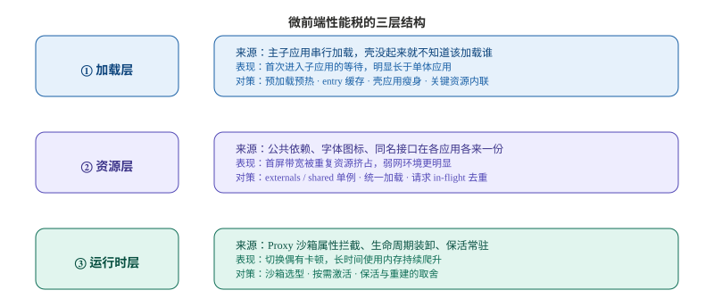
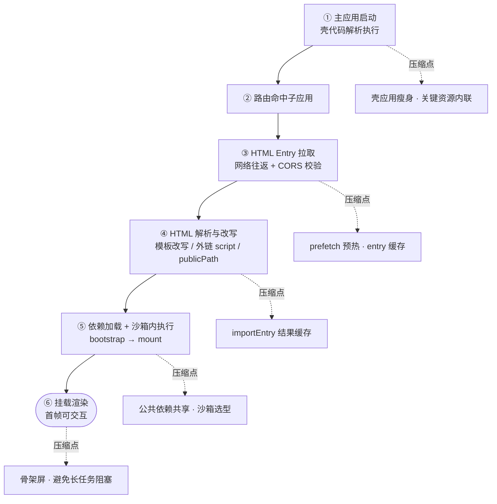
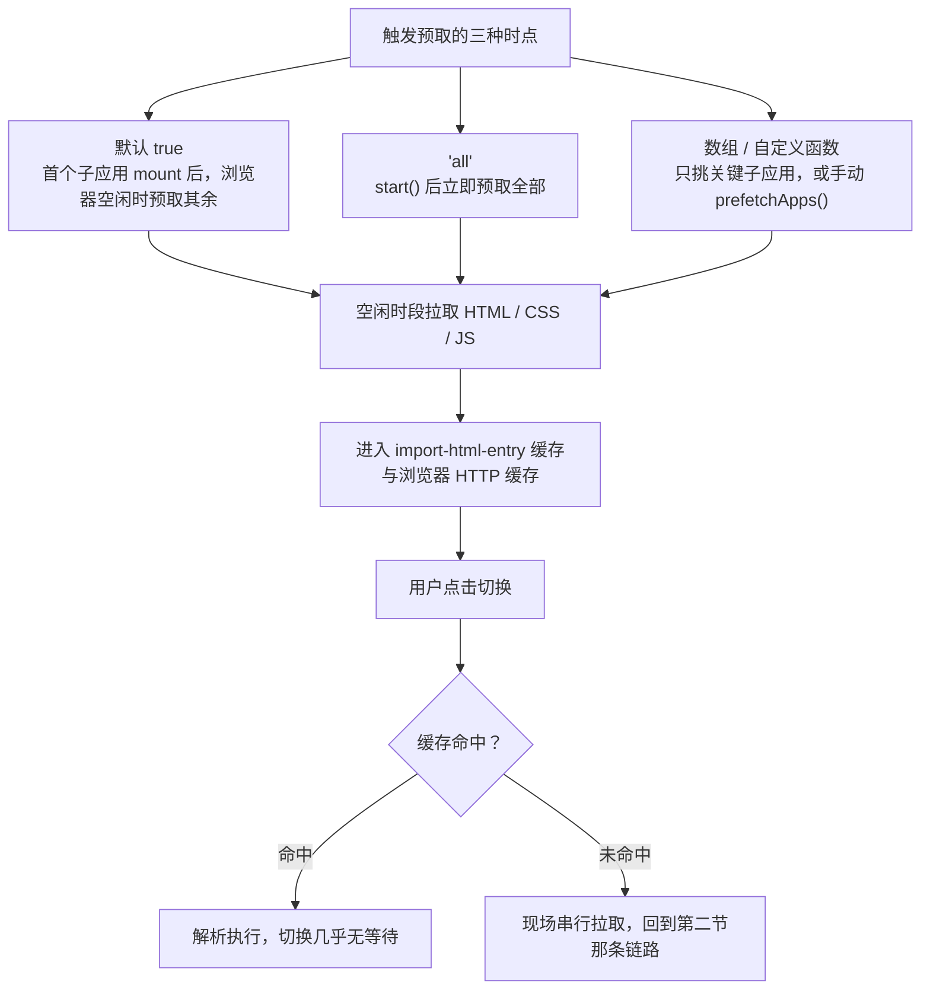
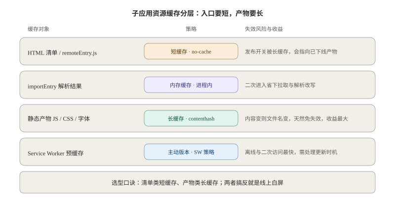
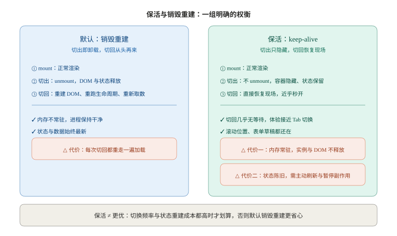
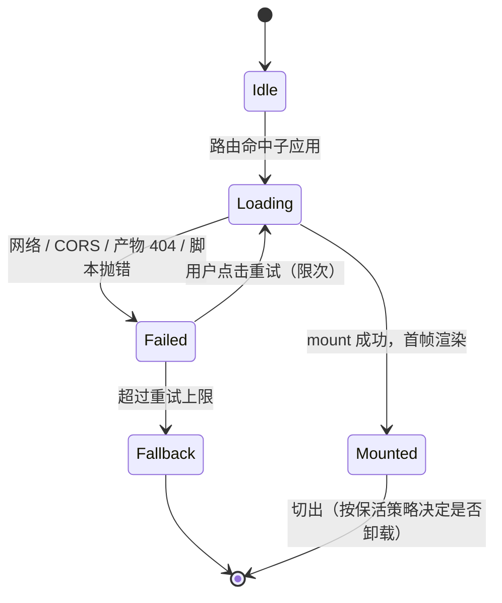

# 第十篇：微前端性能优化实战

**核心要点：**

- 先算「微前端性能税」的账：主子应用串行加载、资源重复请求、沙箱运行时开销——这些是采用微前端的固有代价，优化空间就是把这笔税降回接近单体
- 首屏链路拆解：主应用启动 → HTML Entry 拉取 → 子应用脚本执行 → 挂载渲染，逐段定位可压缩环节（entry 缓存、关键资源内联、主子并行加载）
- 预加载与缓存：qiankun 的 prefetch 策略（首屏后空闲预取）、importEntry 缓存 HTML 解析结果、Service Worker 预缓存子应用静态资源
- 运行时策略：keep-alive 保活模式（切换不卸载、保留状态）的内存代价、子应用按需激活、沙箱代理开销的度量方法
- 资源去重：shared/externals 收敛公共依赖的体积对比、共享后版本升级的连带风险评估（对照第六篇的幽灵升级）
- 白屏治理：子应用切换 loading 与骨架屏、加载失败的兜底渲染、转场动画掩盖加载间隙
- 性能度量基线：以「主应用首屏时间 + 子应用可交互时间」为北极星指标，建立多应用性能看板与回归基线（度量体系对照「性能与体验优化」专栏，本篇只做微前端特有部分）
- 边界验证：虚拟滚动、图片懒加载等子应用内部优化在沙箱环境下是否依然生效，列入集成测试项

> 本文是「微前端架构」技术专栏的第十篇。第九篇的结尾留了一句话：资源管理做对了，性能优化就赢在了起跑线。这一篇承接那份资源账，把镜头从「隔离与去重」转向「加载与运行」：先把微前端的性能税算清楚，再沿着首屏链路逐段找可压缩点，然后是预加载与缓存、运行时策略、资源去重的性能侧账、白屏治理，最后落到度量基线——微前端的性能优化，从「感觉慢」变成「基线可回归」才算完成。

## 一、开篇：先算「微前端性能税」的账

先摆正目标：**微前端不是为了更快，而是为了在拿到「独立开发、独立部署」之后，别比单体慢太多。** 这份多出来的开销，就是「微前端性能税」。

第九篇算的是「重复花钱」的账（同一份依赖打了几遍），这一篇算的是「重复等待」的账。把单体拆成主子应用之后，用户的一次「进入某个业务页面」，从浏览器的视角看变成了：

- 单体时代：一个 HTML 文档，浏览器边解析边发现并**并行**拉取所有资源；
- 微前端时代：先加载并启动主应用（壳），壳根据路由才知道要加载哪个子应用，再拉取子应用的 HTML Entry、解析、执行，最后才渲染出目标页面。

这个「先有壳、才有子应用」的先后关系，是性能税的总源头。它把原本可以并行的加载，切成了若干段**串行**的等待。

微前端性能税分三层：

图解：三层税各自的来源、表现与主要对策。注意三层是**乘法关系**——资源层多打一份依赖，会让加载层的等待更长；运行时层常驻得越多，切换时的内存压力越大。



### 1.1 三层税对照表

| 层级 | 税从哪来 | 用户侧表现 | 主要对策 | 对应章节 |
| :--- | :--- | :--- | :--- | :--- |
| 加载层 | 主子应用**串行**：主应用启动 → entry 拉取 → 脚本执行 → 挂载 | 首次进入某个子应用，白屏时间明显长于单体 | 预加载预热、entry/解析缓存、主子并行、壳应用瘦身 | 第二、三节 |
| 资源层 | 公共依赖、字体图标、同名接口在各应用**各来一份** | 首屏带宽被重复资源挤占，弱网下更明显 | externals/shared 单例、主应用统一加载、请求去重 | 第五节（承接第九篇第六节） |
| 运行时层 | Proxy 沙箱拦截、生命周期装卸、保活常驻内存 | 切换有卡顿、长时间使用内存爬升 | 沙箱选型、按需激活、保活的取舍 | 第四节 |

### 1.2 一条前提：先测再优，而且只测自己造成的部分

性能优化最大的浪费，是凭感觉改代码。微前端场景更复杂，因为「慢」可能来自三个不同的地方：子应用自己的业务代码慢、公共依赖重复拖慢、框架机制的开销。**优化前必须能回答：这一段耗时的责任方是谁。**

所以本文的展开顺序和度量顺序是一致的：先把链路拆成可归责的段（第二节），再逐段优化（第三至六节），最后用基线把「优化有没有生效」锁住（第七节）。

这里先立一条口径，全篇都用它：**只优化微前端特有的部分。** 子应用内部的虚拟滚动、图片懒加载、打包体积优化，属于任何前端项目都要做的事——本文不重复展开，只在第七节收一张「沙箱环境下是否依然生效」的边界验证清单，确保这些优化没有被隔离机制悄悄吞掉。

## 二、首屏链路拆解：把一次「打开子应用」摊开

要看清楚等待发生在哪，最好的办法是把链路画成一条时间轴，每个环节标上「谁在负责、能不能压」。



> 图注：六段串行链路，每一段都发生在用户的等待时间里。虚线指向的是本段对应的压缩手段——第三至六节会逐条展开。真正要压缩的不是「某一段」，而是把这几段能并行的并行掉、能提前的提前掉、能缓存的缓存掉。

### 2.1 逐段看：每一段为什么存在、能压到什么程度

| 阶段 | 这一段在做什么 | 谁负责 | 可压缩点与边界 |
| :--- | :--- | :--- | :--- |
| ① 主应用启动 | 解析并执行壳代码：路由、布局、沙箱初始化、全局状态 | 主应用团队 | 壳应用瘦身（第五篇 §6）；首屏关键 CSS/字体内联；壳的初始化逻辑后置到 idle |
| ② 路由命中 | 根据 URL 匹配到要激活的子应用 | 框架 | 成本极低，但它是「串行」的起点——壳没起来，谁也不知道该加载谁 |
| ③ entry 拉取 | `fetch` 子应用 HTML，跨域场景还要走 CORS 预检 | 框架（import-html-entry） | prefetch 预热、entry 缓存（第三节）；CORS 配置问题在第五篇 §5.5 已展开 |
| ④ HTML 解析改写 | 模板相对路径改写为绝对路径、外链 script 文本化、`__webpack_public_path__` 重写（第四篇 §6） | 框架 | importEntry 结果缓存——同一 entry 二次进入不再重复解析 |
| ⑤ 依赖加载与执行 | 拉取框架/组件库/业务 chunk，在沙箱内执行 `bootstrap → mount` | 子应用 + 框架 | 公共依赖共享降低体积（第五节）；沙箱选型影响执行开销（第四节） |
| ⑥ 挂载渲染 | 子应用首帧渲染、数据请求、图表绘制 | 子应用团队 | 骨架屏占位、避免同步长任务阻塞主线程 |

### 2.2 一个必须记住的认知：首屏是「叠加」的

单体的首屏时间，是「一个应用的首屏时间」。微前端的子应用首屏时间，是：

**主应用首屏时间 + 子应用自身首屏时间**（第一次进入时）

这决定了指标体系不能只看一个数：**主应用首屏要衡量「壳能不能尽快可用」，子应用可交互时间要衡量「业务页面能不能尽快用」。** 两者的优化手段完全不同——前者靠壳瘦身与内联，后者靠预加载、缓存与依赖共享。这正是第七节「北极星指标」要拆成两个的原因。

## 三、预加载与缓存：把等待提前到用户不忙的时候

链路既然是串行的，最有效的思路就两条：**能提前的提前（预加载），能复用的复用（缓存）。**

### 3.1 预加载：qiankun 的 prefetch 三种口径

预加载的默认值就是**开启**的：`prefetch: true` 的语义是「第一个子应用完成 mount 之后，浏览器空闲时，预取其余子应用的 HTML / CSS / JS」（第四篇 §9）。需要更激进的时机，就换成 `'all'`——`start()` 之后立刻预取全部。

```js
import { registerMicroApps, start } from 'qiankun';

registerMicroApps([...]);

start({
  // 默认 true：首个子应用 mount 后，浏览器空闲时预取其余
  // 'all'：start 后立即预取全部；也可传应用名数组，或传函数自定义筛选
  prefetch: 'all',
});
```

三种口径的适用场景：

| 口径 | 触发时机 | 适合 | 风险 |
| :--- | :--- | :--- | :--- |
| `true`（默认） | 首个子应用 mount 之后的空闲时段 | 绝大多数后台系统：不影响首屏，又提前拿到后续资源 | 几乎无 |
| `'all'` | `start()` 之后立即 | 菜单可预测、子应用数量少、首屏带宽有余量 | 与首屏抢带宽，可能拖慢主应用自身首屏 |
| 数组 / 函数 | 按名单或自定义规则挑选 | 只有少数子应用是高频入口 | 需要人工维护名单 |



> 图注：预加载做的事，是把链路里第 ③④⑤ 段的网络等待，从「用户点击的那一刻」平移到「浏览器空闲的那一段」。命中与否，直接决定切换是「秒开」还是「重走一遍串行」。

需要提醒的是，**预加载不是越多越好**（第四篇 §9 已给过这个权衡）：盲目全量预取会带来额外带宽开销和首屏资源竞争。判断标准很简单——**如果用户的下一步大概率是切到另一个子应用（后台菜单、工作台），预取就是纯赚；如果是营销页那样「进来浏览一下就离开」，预取只是白烧流量。**

### 3.2 缓存：把「拉过的东西」记住，而且记住的是正确的层级

微前端的缓存不是一个开关，而是**分层**的——不同层的失效策略完全不同，搞反了就是线上事故：

图解：四层缓存各自的缓存周期与失效风险。关键在「策略」一列：**清单类资源必须短缓存，产物类资源才能长缓存**——两者搞反，就是「线上偶发白屏」的成因（第六篇 §8.4）。



| 缓存对象 | 建议策略 | 理由与风险 |
| :--- | :--- | :--- |
| HTML 清单 / `remoteEntry.js` | 不缓存或极短缓存（`no-cache` / 秒级） | 它是「发布开关」；被长缓存后会指向已下线的旧产物 → 白屏（第六篇 §8.4） |
| importEntry 解析结果 | 内存缓存（进程内，刷新即失效） | 同一子应用二次进入不再重复「拉取 + 解析改写」 |
| 静态产物（JS / CSS / 字体） | contenthash + 长缓存（`immutable`） | 内容变了文件名就变，天然免失效；这是最大的一块收益 |
| Service Worker 预缓存 | 主动版本管理 + 更新策略 | 离线与二次访问最快，但要自己处理「新版本何时生效」 |

其中第二层（importEntry 解析结果缓存）最容易被忽略，也最体现微前端的特殊性：**子应用的入口不是一段 JS，而是一份要经过改写、注入的 HTML。** 第二次进入时，这份 HTML 的「拉取 + 解析 + 改写」本来可以完全省掉——框架层已经做了进程内缓存，需要你确认的是**别用乱七八糟的查询串破坏缓存键**（例如给 entry 拼时间戳）。

## 四、运行时策略：保活、按需激活与沙箱开销

加载优化的是「第一次进来」；运行时优化的是「进来之后」——切换快不快、内存稳不稳。

### 4.1 保活：切换不卸载，用内存换首屏

默认行为下，子应用切出就 `unmount`，再切回来是**完整重来一遍**（重建 DOM、重跑 `bootstrap → mount`、重新请求数据）。保活（keep-alive）反过来：切出时只隐藏，DOM 与状态都留在容器里，切回即恢复现场。

三个框架的支持度不同（第七篇 §4.1 有对照表）：micro-app 是 `<micro-app keep-alive>` 一行属性；wujie 是 `alive` 原生支持；**qiankun 没有内置保活，需要自己封装**（用 `loadMicroApp` 拿到实例后不调用 `unmount`，只切换容器的显隐）。

图解：保活与「销毁重建」是一组明确的权衡，不存在只赚不赔的选项。左边是默认行为，右边是保活；右侧多出来的两块（内存常驻、状态陈旧）就是保活的价格。



选型的判断标准可以落成一句话：**当「切换频率」与「状态重建成本」都高时，保活才划算。**

- 适合保活：频繁来回切换的 Tab 页、工作台、需要保留滚动位置与表单草稿的场景
- 不适合保活：低频入口、数据实时性要求高（保活会带来状态陈旧）、子应用内存占用大（常驻会持续累积）

选择保活之后，有三件事必须补上，否则「省下的首屏」会以别的方式还回去：

1. **内存要盯**。保活的本质是把子应用的运行时留在内存里，应用的实例、图表、DOM 都不会释放。子应用数量越多、单个越重，常驻内存越高——把它纳入第七节的看板。
2. **状态要刷新**。保活的应用不会重新拿数据，权限变更、主题切换、列表更新都得靠通信主动推（第九篇 §5.2 的主题方案就是这个套路）。
3. **副作用要暂停**。切出后定时器、轮询、订阅还在跑，属于「看不见的性能税」——保活时应当暂停，而不是指望 `unmount` 里的清理逻辑（它根本不执行）。

### 4.2 按需激活：不是所有子应用都值得预加载

保活解决「切回来的快」，按需激活解决「不该加载的别加载」：

- **路由级懒加载**：只有命中路由时才注册/激活对应子应用
- **组件级局部嵌入**：用 `loadMicroApp` 把一个子应用挂到页面中的某一块，而不是整页切换（番外篇四的局部嵌入场景）
- **可见才加载**：Tab、折叠面板、抽屉里的子应用，等到首次可见再加载，配合 `IntersectionObserver` 触发

### 4.3 沙箱开销：怎么度量、什么时候值得在意

JS 沙箱不是零成本的，开销主要来自两处（第四篇 §4）：

- **ProxySandbox 的每次属性读写**：`get` 陷阱要为每次读取判断一次「key 在不在自己的 `fakeWindow` 里」，不在才回退到真实 `window`；`set` 顺带做代理写入。单次微小，但业务代码里的高频属性访问会把它累积成可观的开销。
- **沙箱的额外职责**：修正 `window.window / self / top / parent` 指向代理、用 `has` / `getOwnPropertyDescriptor` 陷阱应对属性探测型库、卸载时回收定时器与事件监听——这些都在运行时持续发生。

对照之下，快照沙箱（SnapshotSandbox）每次激活都要**全量遍历 `window`** 做快照与恢复，性能最差且只支持单实例；三种沙箱的性能对比在第四篇 §4.4 有表。**结论不是「选最快的那种」，而是「在满足隔离需求的前提下别选更重的」**：兼容性要求不高就用 ProxySandbox，需要退快照时再评估多实例与切换频率。

至于「沙箱到底拖慢了多少」，不要估，要测：

- 用 Performance 面板看切换过程中的**长任务**（`longtask`）是否集中在框架的 mount/unmount 阶段；
- 自研打点：在激活前后各取一次 `performance.now()`，把「框架耗时」与「子应用自身渲染耗时」分开记录；
- 对照实验：同一子应用分别用 Proxy 沙箱与快照沙箱各跑一遍切换，差值就是沙箱机制的成本上限。

## 五、资源去重：把「重复」从链路上抹掉

第九篇第六节已经把「三种重复」讲透了（公共依赖、字体图标、同名 API），并给了对策。这一节从其性能侧补两句**账**，回答「为什么值得单独花力气做去重」。

**第一笔账是体积。** 下面的「React + ReactDOM + 组件库约 300KB gzip」只是示例估算，实际值必须按项目构建产物测量。假设四个子应用各打一份，才会得到约 1.2MB 的重复传输（第九篇 §6.1 的估算）。在首屏路径上，这不是「多下载 900KB」这么简单——它会同时占用并发连接、挤压真实业务资源的下载窗口。

**第二笔账是缓存粒度。** 各应用把同一依赖打成各自带 hash 的产物，浏览器会把它当作**不同资源**各存一份：四个应用四条缓存条目，用户换一个应用就要重新下载一遍「同一个 React」。

去重的收益与代价，值得按「重复体积 × 应用数」来判断，而不是一律共享：

| 方案 | 性能侧收益 | 性能侧代价 / 风险 |
| :--- | :--- | :--- |
| externals + CDN 全局单例 | 一次加载全员复用，浏览器缓存命中率高 | 引入「子应用依赖主应用先加载好全局变量」的隐性契约（第九篇 §6.1） |
| Module Federation `shared` 单例 | 版本可协商，无全局变量污染 | `remoteEntry.js` 多一次清单请求；实现 chunk 还要再拉一次（第六篇 §2.4） |
| 不共享，各带一份 | 版本互不干扰，发布解耦 | 体积与缓存双重重复；框架多实例还可能直接报错 |

**共享不是免费的。** 除了上面表里的网络代价，还有一类更贵的隐性成本：**幽灵升级**——提供方一次常规发版，通过 `singleton` 把所有消费方静默切到新版本，改变了从未发版的应用的运行时行为（第六篇 §4.3）。所以「共享框架与大型 UI 库」几乎总是值得的，而「共享一个只有几 KB 的工具库」往往只换来一次额外请求和一份版本治理负担。**「一个页面只能有一个 React（或 Vue）实例」这条版本红线始终成立；在这条红线之上，共享的边界要自己画。**

## 六、白屏治理：把「等待」和「失败」都做成体验

前面的优化都在缩短等待，但**只要还有等待，就需要有人为这段空白负责**。而微前端比单体更容易白屏，原因是加载路径更长、失败点更多：

- entry 拉取失败：网络抖动、跨域未配置 CORS（第五篇 §5.5）
- 产物 404：部署在子目录但 publicPath 没对齐、清单被长缓存指向已下线产物（第六篇 §8.4）
- 子应用脚本抛错：框架版本不兼容、依赖缺失、沙箱内执行环境差异

治理分三层：**占位、兜底、过渡。**



> 图注：每个状态都要有对应的界面。`Idle → Loading` 之间不能是纯白屏——那是用户感知最差的一帧；`Failed` 不能是一个不动的错误提示，要有重试入口；重试仍失败要有降级页（`Fallback`），而不是让整个壳一起崩掉。

1. **占位：loading 与骨架屏**。子应用切换时先渲染一个与目标页面结构近似的骨架屏，让「等待」看起来像「正在加载」而不是「页面坏了」。注意骨架屏要按子应用的**首次进入**设计：第一次进入走骨架屏，保活的应用切回时应该直接出现，不该再闪一次骨架。
2. **兜底：加载失败的降级渲染**。给子应用容器套一层错误边界，捕获加载失败与渲染抛错，渲染「重试 + 反馈」的兜底 UI，并支持运行时重试（第六篇 §9 的坑清单里给过这套组合）。兜底页的文案要能说清是「这个模块暂时不可用」，而不是让用户怀疑整个系统。
3. **过渡：转场动画掩盖加载间隙**。切换时的淡入/位移动画能把注意力从「空白」转移到「变化」上，但要注意两点：动画只做视觉过渡，不要拖长真实可交互时间；`prefers-reduced-motion` 下应当关闭。

最后一条原则：**白屏（尤其是失败）必须能归因到具体子应用。** 「首页白了」这种报警没有意义，要能回答「是哪个子应用的哪一次加载、失败在哪一段」。这既是第九篇 §7「按应用归责」的延续，也是第十一篇异常自动降级与监控归因的输入。

## 七、性能度量基线：从「感觉慢」到「基线可回归」

优化做完，一定要能被验证。微前端的性能度量有三个特殊要求：**分主子、分首次/切换、能归因。**

### 7.1 北极星指标：两个，不是一个

| 指标 | 衡量什么 | 采集方式 | 说明 |
| :--- | :--- | :--- | :--- |
| 主应用首屏时间 | 壳多快可用（布局、菜单、路由就绪） | `PerformanceObserver` 的 `paint` / `navigation` | 与子应用无关，靠壳瘦身与内联 |
| 子应用可交互时间 | 业务页面多快能用 | 自研打点：`mount` 前后 `performance.now()` + 首个可交互时刻 | 要区分「首次进入」与「保活切回」两条曲线 |

为什么必须拆成两个？因为它们的责任方不同：主应用首屏慢，是主应用团队的问题；子应用可交互慢，要看是依赖重复、entry 未预热，还是子应用自己的首屏逻辑。**一个笼统的「页面加载时间」，会把这三种责任搅在一起，谁都改不动。**

### 7.2 采集、看板与回归基线


> 图注：闭环的关键在「归因」两个字——没有子应用维度的标记，看板只能说「变慢了」，说不了「谁慢、慢在哪一段」。这与第九篇 §7 的隔离健康度看板是同一套方法论：**先给资源打归属标记，再谈度量。**

- **归因维度**：所有指标都要带「子应用名 + 版本号」，否则无法回答「是哪个版本的哪个应用引入的退化」。
- **回归基线**：每次发版与上一版基线对比，超过阈值（例如子应用可交互时间 +20%）告警，作为发版准入门槛之一（第十一篇的准入与卡口会接管这条门禁）。
- **体积预算**：把第九篇 §6.4 的重复依赖度量（bundle 分析：重复模块占比）纳入同一张看板——公共依赖重复占比、子应用产物增量，都是首屏时间的上游指标。

### 7.3 边界验证：子应用内部的优化，在沙箱里还生效吗

最后一件事最容易被忽略：**子应用团队做的常规前端优化，在微前端的运行环境里可能悄悄失效。** 这些不是本文要教的优化，而是必须进入集成测试的验证项（应作为条目列入第十二篇的联调清单）：

| 子应用内部优化 | 在沙箱/隔离环境下的风险 | 验证方式 |
| :--- | :--- | :--- |
| 图片懒加载、`IntersectionObserver` | 依赖原生 `window`/`document` 的库在 Proxy 假全局下行为异常 | 在真实微前端容器内跑一遍，不只看子应用独立运行 |
| 虚拟滚动 | 容器高度、滚动事件绑定在 `mount` 后重新计算，卸载重挂时可能错位 | 切换一次再切回，检查滚动位置与可视区 |
| 骨架屏 / 请求预取 | 与主应用的下发数据（用户信息、字典）重复，反而变慢 | 结合第五节的请求去重一同验证 |
| keep-alive 保活 | 依赖 `unmount` 的清理逻辑不执行，定时器与订阅泄漏 | 保活切出后观察定时器/轮询是否仍在跑 |

一句话：**子应用独立跑得飞快，不等于在微前端容器里也快。** 所有性能结论都要在集成环境里复核。

## 八、小结

把全文收回到一句话：

**微前端性能优化的本质，是把「拆分带来的额外等待」一段段找出来，能提前的提前、能复用的复用、能并行地并行，剩下的等待与失败都用体验兜住，最后用基线把它锁死。**

落地 checklist：

1. **先算税，再动手**：把等待拆成加载层、资源层、运行时层，明确每一段的责任方——不测不优
2. **拆链路，逐段压**：主应用启动（壳瘦身）→ entry 拉取（预热 + 缓存）→ 解析（importEntry 缓存）→ 执行（依赖共享 + 沙箱选型）→ 挂载（骨架屏）
3. **预加载看场景**：`prefetch: true` 是稳妥默认，`'all'` 只在菜单可预测、带宽有余量时用；别让预取和首屏抢资源
4. **缓存分层，别搞反**：清单类短缓存、产物类长缓存——搞反就是线上白屏
5. **保活是权衡**：切换频率与状态重建成本都高才保活，保活后要盯内存、刷状态、暂停副作用
6. **去重按账算**：共享框架与大型 UI 库几乎总是值得，小工具库要算清「请求 + 治理」的成本，守住「一个页面一个框架实例」的红线
7. **白屏要有界面**：loading/骨架屏、失败兜底与重试、过渡动画三件套，且失败必须能归因到具体子应用
8. **度量分主子、分首次/切换**：两个北极星指标 + 回归基线 + 边界验证清单，让性能优化从「感觉」变成「执法」

到这一步，「拆分」带来的技术债基本都处理完了：隔离（第九篇）、通信（第八篇）、性能（本篇）各就各位。但一个能跑的系统，还不等于一个**能长期运营**的系统——新子应用怎么准入、规范怎么变成卡口、出了问题怎么灰度回滚。下一篇《微前端治理与发布体系》就来回答这个问题：把散落各篇的「约定」，升级成平台层面的「约束力」。
