# 第十三篇：微前端与 Monorepo——如何协同管理大型项目

**核心要点：**

- 先分清两个问题：微前端解决「运行时」的应用组合，Monorepo 解决「代码仓库」的协作与复用——正交问题，但落地时经常一起上，混淆会导致过度工程
- 工具选型现状：pnpm workspace 作为基座 + Turborepo/Nx 做任务编排是当前主流，Rush 面向超大规模企业治理（构建体系细节对照「工程化」专栏 Monorepo 篇，本篇聚焦与微前端的结合）
- 仓库拓扑决策：主子应用同仓（利于原子变更、共享升级、代码检索）vs 分仓（利于独立权限、独立发布节奏、避免 CI 噪音）——拆分边界最好与团队边界对齐（康威定律呼应第二篇）
- 共享代码管理：通信 SDK、公共组件、工具库做成 internal package 的版本策略（固定版本 vs workspace:* 实时引用），以及「共享包升级要不要同步锁死所有子应用」的两难
- 构建与缓存：增量构建（只构建受影响应用）、远程缓存对本地与 CI 体验的提升、子应用产物与部署的解耦
- 依赖治理：公共依赖统一升级策略、lockfile 管理口径、幽灵依赖防治——微前端里依赖不一致会直接变成运行时冲突（呼应第六篇 shared）
- 落地建议：先 Monorepo 后微前端是常见合理顺序——先统一工程设施降低协作成本，再按需做运行时拆分

## 一、开篇：微前端和 Monorepo，是两个问题

微前端系列讲到这里，运行时的事（编排、隔离、通信、性能、发布、测试）基本讲完了。但一个真实的大型项目要跑起来，还有一个维度的问题没展开：**这些主子应用的代码，放在哪、怎么协作、怎么发布？**

于是绕不开 Monorepo。但在展开之前，先处理讨论区出镜率最高的一类问题：

> 「我们要搞微前端，是不是得先上 monorepo？」
> 「我们已经把仓库拆成多个 app 目录了，这算微前端了吗？」

两个问题的答案都是「不是」。因为它们根本不在同一个维度上：

- **微前端回答的是「运行时」问题**：多个独立构建、独立部署的应用，如何在同一个页面里组合、隔离、通信；
- **Monorepo 回答的是「仓库」问题**：多个包/应用，如何在同一个代码仓库里共享代码、统一工程设施、原子化变更。

两者**正交**：任何一边都可以单独成立。把它们放在两个维度上，就得到了所有项目的四种组合：

| 组合 | 仓库形态 | 运行时形态 | 典型场景 |
| --- | --- | --- | --- |
| A | 单仓 | 单体应用 | 绝大多数项目的起点，没什么好拆的 |
| B | **单仓** | **微前端** | **本篇主场**：主子应用同仓，运行时编排 |
| C | 分仓 | 单体应用 | 几个互不相干的独立系统 |
| D | 分仓 | 微前端 | 主子团队完全独立、需独立权限管控的整合 |

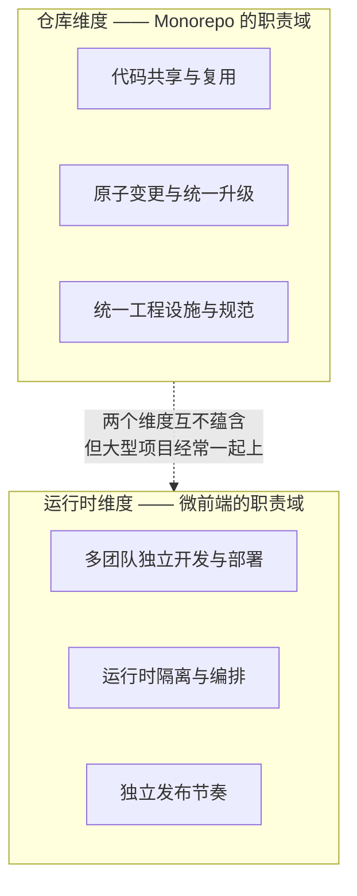

为什么要专门校准这层关系？因为混淆它会从两个方向翻车：

- **把 Monorepo 当成微前端**：目录拆成了 `apps/*`，但构建发布还是「整仓一发全量」，团队以为拿到了「独立部署」，实际上什么都没变——这是最常见也最危险的误解；
- **为了微前端强行上全套 Monorepo**：三五个子应用、一个团队维护，却一上来 Nx + Rush + 私服全家桶，工具复杂度远超协作收益——典型的过度工程。

本篇的展开顺序就是「两个问题的正确关系」：先讲仓库拓扑怎么选（第二节），再讲工具链基座（第三节）、目录结构（第四节），然后是与微前端结合最深的四个专题——共享代码版本策略（第五节）、增量构建与缓存（第六节）、依赖治理（第七节）、联调体验（第八节），最后给落地路线（第九节）。pnpm/Turborepo 本身的构建体系细节对照「工程化」专栏的 Monorepo 篇，本篇只讲与微前端结合的部分。

## 二、仓库拓扑：主子应用放一个仓库，还是各放各的

### 2.1 先说结论：微前端对仓库拓扑没有硬性要求

技术上，qiankun 靠 HTML Entry 注册子应用、MF 靠 remoteEntry 地址联邦，它们只关心「子应用产物在哪个 URL 上」，**不关心代码在哪个仓库里**。所以「微前端 = 必须 monorepo」从一开始就不成立。

那为什么这道题总是和微前端绑在一起讨论？因为**大型微前端项目几乎必然产生共享代码诉求**——主子应用之间要共享通信 SDK（第八篇）、共享类型契约、共享工具与组件（第二篇依赖治理的延伸）。共享代码的仓库形态（同仓 workspace 直链，还是跨仓 npm 私服），直接决定了协作的顺滑程度。这才把 Monorepo 拉进了话题。

### 2.2 同仓：得到什么，付出什么

主子应用放进同一个仓库（通常伴随共享包一起），收益是实打实的：

- **原子变更**：一次 PR 同时改主应用路由和子应用适配，评审、合并、构建一气呵成——分仓时这是「两个 PR + 发布顺序编排 + 联调确认」的马拉松；
- **共享即引用**：`packages/*` 通过 workspace 协议直接链接，改完保存即生效，没有发版环节；
- **统一工程设施**：ESLint、tsconfig、CI 模板、依赖版本口径只有一份，不存在「各仓配置漂移」；
- **全局检索与重构**：跨主子应用的全局搜索、重命名、调用链分析在一个仓库里一次完成。

代价也要心里有数：

- **CI 噪音**：任何提交都可能触发多个应用的构建，没有增量构建体系（第六节）的话，流水线等待会快速恶化；
- **权限粗粒度**：仓库级权限对「子应用分属不同业务方」的场景不友好，只能靠 CODEOWNERS 做目录级折衷；
- **仓库健康**：体积、提交历史、clone 时间随应用数量线性膨胀。

### 2.3 分仓：得到什么，付出什么

分仓的收益恰好是同仓的镜像：

- **权限与节奏完全独立**：子应用各归各的团队，各发各的版，互不阻塞（第十一篇的独立发布体系天然成立）；
- **CI 天然隔离**：一个仓库的提交只影响自己，流水线简单直接；
- **仓库保持干净**：每个仓库规模可控。

代价：

- **共享代码走慢链路**：公共包要发 npm 私服（或 git 依赖），提供方发版 → 消费方逐个升级 → 逐个构建发版，传播链路长（第六篇开篇吐槽过的那条链）；
- **跨仓变更无法原子化**：通信协议升级要「改 SDK 仓库 → 发版 → 各子应用仓库逐个接入」，中间态的版本组合矩阵是联调地狱（第十二篇的痛点来源）；
- **工程设施漂移**：各仓的 lint 规则、依赖版本、CI 模板各自演化，规范靠自觉。

### 2.4 决策原则：边界对齐团队，允许渐进再拆

两条腿的对比摆完了，决策原则收敛成一句话：**仓库边界尽量与团队边界对齐（康威定律，呼应第二篇），协作紧密的放同仓，权限隔离的放分仓。**

实践里最常见的是**混合拓扑**：主应用与核心子应用（同一团队群、高频协作、共享通信 SDK）同仓；边缘子应用（独立业务线、低频变更、需要独立管控）分仓。混合拓扑不是妥协，而是康威定律的正确落地。

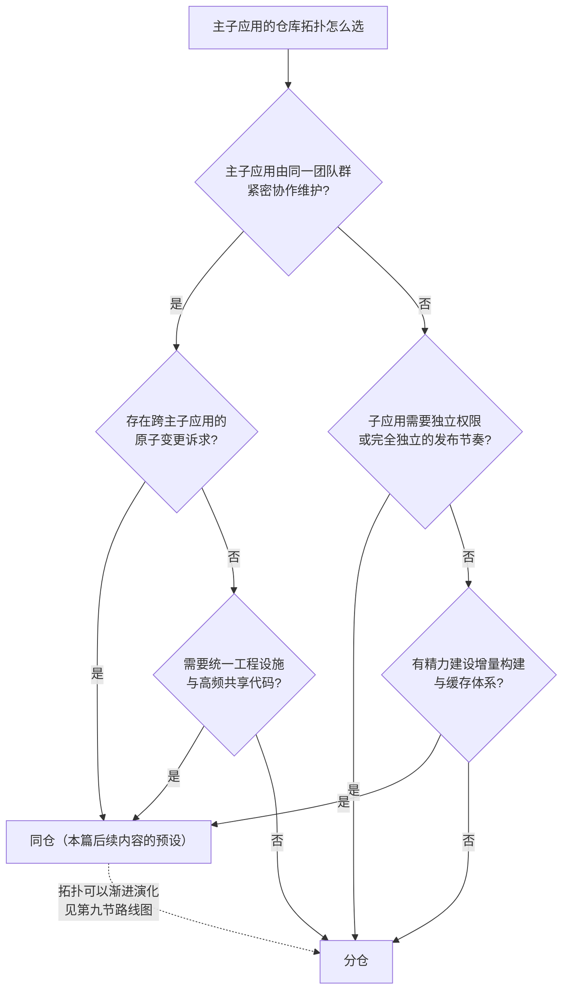

注意决策树里的最后一层：**团队没有增量构建能力时，同仓要慎重**——五个子应用的仓库没有 turbo/Nx 兜底，每次提交全量构建，CI 队列会把协作效率拖垮。这不是吓唬，是同仓方案的第一死因。

## 三、工具链基座：pnpm workspace 打底，任务编排提效

同仓方案的工具链，当前社区已经收敛出一套清晰的分层结构。先把分层图立起来，再逐层展开：

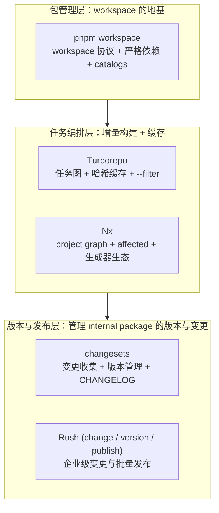

### 3.1 pnpm workspace：为什么它是事实基座

三层结构里，pnpm 之所以能坐稳地基位置，靠的是三个机制，每一个都恰好命中微前端仓库的痛点：

**第一，内容寻址存储 + 硬链接，安装快、磁盘省。** pnpm 把所有下载过的包按内容哈希存进全局 store，项目里的 `node_modules` 文件是指向 store 的硬链接——同一个 lodash 在十个项目里物理上只存一份，安装从「下载」变成「链接」。对应用数量多的微前端仓库，这个收益会被放大。

**第二，严格的 node_modules，幽灵依赖无处藏身。** pnpm 的 `node_modules` 里只有 `package.json` 声明过的直接依赖（以符号链接指向 `.pnpm` 虚拟目录），没有 npm/yarn 那种「依赖的依赖被提升到顶层」的扁平化。于是「代码里 import 了一个没声明的包」这种幽灵依赖，从「能跑的巧合」变成「一眼可见的报错」。微前端场景里这格外重要：**依赖声明不真实，第七节要讲的运行时依赖治理就无从谈起。**

**第三，workspace 协议，internal package 的一等公民化。** 依赖版本写成 `workspace:^` 时，同仓内安装直接链接到源码目录，发布时自动改写成真实版本号（第五节展开）。这让 `packages/*` 里的共享包像 npm 包一样被声明和管理，实际却走本地直链。

落地配置非常薄：

```yaml
# pnpm-workspace.yaml
packages:
  - "apps/*"      # 主应用 + 各子应用
  - "packages/*"  # 共享包：SDK、组件、工具、配置
```

```yaml
# pnpm-workspace.yaml：catalogs 示例
# catalogs 的语法和最低版本以当前 pnpm 官方文档为准；
# 不同 pnpm 版本升级前应先在 CI 中验证。
catalog:
  react: ^18.3.1
  react-dom: ^18.3.1
  antd: ^5.21.0
```

```jsonc
// apps/dashboard/package.json
{
  "name": "@platform/dashboard",
  "dependencies": {
    "react": "catalog:",
    "@platform/runtime-sdk": "workspace:^"
  }
}
```

`catalog:` 是第七节「统一升级」的关键抓手，`workspace:^` 是第五节「版本策略」的关键抓手——先把这两个记号混个脸熟。

### 3.2 Turborepo：任务图 + 哈希缓存

pnpm 解决的是「包怎么装」，但「构建怎么跑」它不管——五个应用加八个共享包，`pnpm -r build` 是无增量的全量串行。Turborepo 补的就是这一层：**它把仓库抽象成任务依赖图，基于输入哈希做构建缓存**。

```jsonc
// turbo.json（Turborepo v2 格式）
{
  "$schema": "https://turbo.build/schema.json",
  "tasks": {
    "build": {
      // 先构建依赖的包：apps/dashboard 的 build 之前，
      // 它依赖的 @platform/shared-components 等会先完成 build
      "dependsOn": ["^build"],
      // 声明产物路径：缓存命中的依据，漏声明 = 脏缓存（第六节细讲）
      "outputs": ["dist/**"]
    },
    "dev": {
      "cache": false,
      "persistent": true
    }
  }
}
```

```bash
# 只构建 main 及它依赖的所有包（受影响构建）
turbo build --filter=@platform/main...

# 只构建「依赖了 main」的包（反向受影响，少见但有用）
turbo build --filter=...@platform/main
```

核心心智：**`--filter=X...` 的省略号是「连带依赖」的意思**。这个命令形态会和第六节的增量构建、第八节的联调编排反复配合。

### 3.3 Nx、Rush 与 Lerna：各自站在哪

| 工具 | 定位 | 核心能力 | 适合谁 |
| --- | --- | --- | --- |
| pnpm workspace | 包管理基座 | workspace 协议、严格依赖、catalogs | 所有方案的地基，没有之一 |
| Turborepo | 任务编排 + 缓存 | 任务图、输入哈希、远程缓存、`--filter` | 中小到大型仓库，低侵入、上手快 |
| Nx | 任务编排 + 工程平台 | project graph、`nx affected`、生成器/插件生态、分布式执行 | 大型仓库、需要代码生成与强约束的团队 |
| Rush | 企业级仓库治理 | 变更管理（rush change）、批量发布、lockstep 版本、策略强制 | 超大规模、多团队强管控的企业仓库 |
| Lerna | （历史角色）独立版本发布 | 已由 Nx 团队接管维护 | 存量项目，新项目一般直接选 Nx 或 Turborepo |

选型上不用纠结太久：**绝大多数微前端仓库，pnpm workspace + Turborepo + changesets 这套「默认组合」就是当前的最优解**；需要生成器和工程约束时再上 Nx；Rush 留给「几百个包、几十个团队、需要策略治理」的超大规模企业场景。本篇后续内容全部以默认组合为背景展开。

## 四、目录结构：一个微前端 monorepo 的标准形状

把前面两节的选择落到磁盘上，标准形状长这样：

```text
micro-app-platform/
├── apps/
│   ├── main/                  # 主应用（基座）：注册子应用、路由分发、全局布局
│   ├── dashboard/             # 子应用：数据看板
│   ├── order/                 # 子应用：订单中心
│   └── setting/               # 子应用：系统设置
├── packages/
│   ├── runtime-sdk/           # 通信 SDK：主子通信协议与实现（第八篇的落地形态）
│   ├── shared-components/     # 公共业务组件
│   ├── shared-utils/          # 工具函数
│   ├── eslint-config/         # 共享 ESLint 配置
│   └── tsconfig/              # 共享 TS 配置
├── pnpm-workspace.yaml        # workspace 声明 + catalogs
├── pnpm-lock.yaml             # 唯一 lockfile（第七节）
├── turbo.json                 # 任务编排（第三节）
└── package.json
```

两张表把职责说清：

| 目录 | 角色 | 构建产物 | 部署单元 |
| --- | --- | --- | --- |
| `apps/*` | 可独立部署的应用 | 独立 dist | 独立站点/CDN 路径 |
| `packages/runtime-sdk` | 跨应用协议层 | 无独立产物（被打进各应用，或走 MF shared） | — |
| `packages/shared-components` | 共享 UI 资产 | 无独立产物（同上） | — |
| `packages/*-config` | 工程设施 | 无产物，构建期配置 | — |

关键认知：**`apps/*` 里的每一个包，都是「独立构建、独立产物、独立部署」的完整单元**。这是第一节澄清过的那条底线——monorepo 只是让它们住在同一个仓库里，运行时各是各的。整篇最核心的一张图，把「构建期共享」与「运行时隔离」两个主场画在一起：

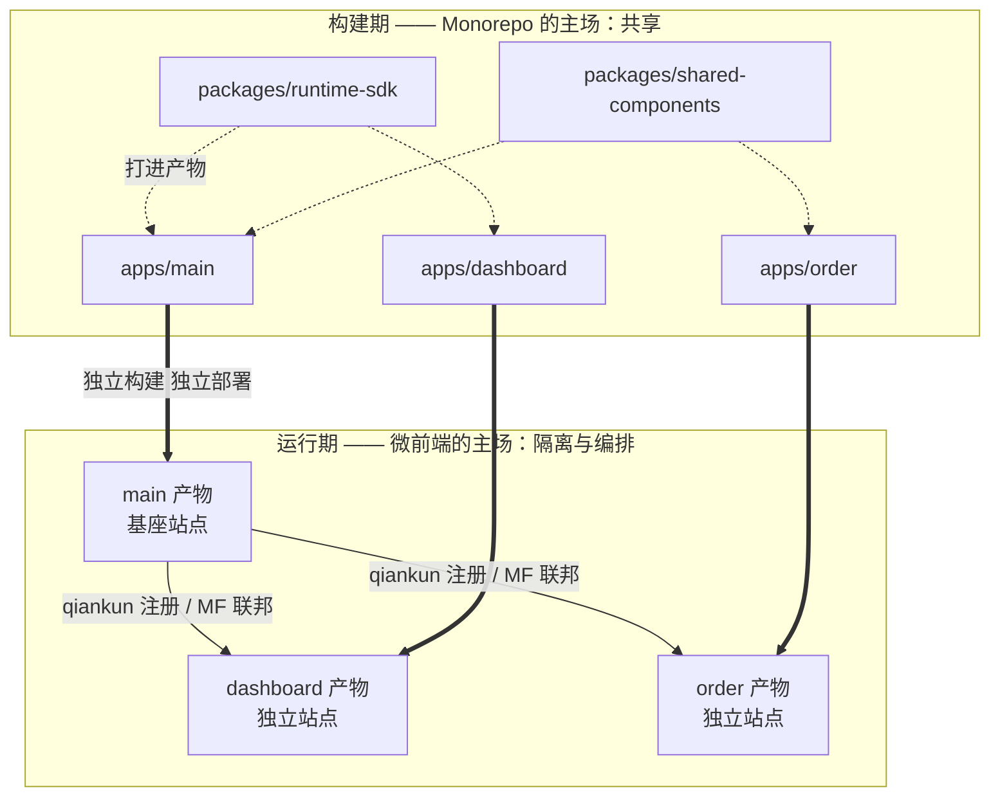

上半部分是本篇要讲的一切（共享、版本、缓存、依赖治理），下半部分是前十二篇讲过的一切（编排、隔离、通信、发布）。**两半各干各的，衔接点只有一条：`apps/*` 的构建产物要满足微前端入口协议**（qiankun 的 HTML Entry 约定，或 MF 的 remoteEntry 产物）。

图解：下面这张图把「双主场」画得更直观——构建期共享包（紫）被打进各应用（琥珀）的产物，运行期基座站点（绿）编排各子应用站点，中间那条「独立构建 · 独立部署」的箭头，就是整篇的题眼。

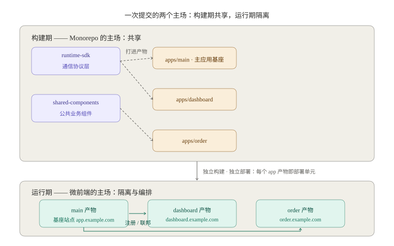

## 五、共享代码：internal package 的版本策略

`packages/*` 建起来了，马上遇到第一个真问题：**共享包的版本怎么管？**同一份 `runtime-sdk`，子应用是永远用最新代码，还是锁定某个版本？这不是技术细节，是协作模式的分叉点。

### 5.1 两条路线：实时引用与固定版本

**路线一：`workspace:^` 实时引用。** 共享包不维护独立版本（`package.json` 里标 `private: true`），下游一律写 `workspace:^`，安装时直接链接源码。效果是「改共享包，保存即全仓生效」。

**路线二：固定版本引用。** 共享包走正式版本管理（changesets，5.3 节），下游 `package.json` 写死 `^1.2.0`，发布新版本后由消费方自行决定何时升级。

| 维度 | `workspace:^` 实时引用 | 固定版本引用 |
| --- | --- | --- |
| 变更传播 | 保存即全仓生效 | 发布新版后，消费方手动升级 |
| 版本一致性 | 天然全局一致，无多版本 | 升级期存在多版本共存 |
| 风险 | 下游被动升级，破坏面大（仓库版「幽灵升级」，类比第六篇 4.3） | 升级惰性，版本碎片化 |
| 版本追溯 | 无版本号可查，只能靠 git 历史 | 有语义化版本 + CHANGELOG |
| 适合 | 协议层：通信 SDK、共享类型 | 独立演进：工具库、业务组件库 |

```mermaid
flowchart TD
    A["internal package 用哪种引用方式"] --> B{"包变更时<br/>下游要不要立即感知?"}
    B -->|"要：协议层必须全局一致"| C["workspace:^ 实时引用"]
    B -->|"不要：按需升级"| D["固定版本 + changesets"]
    C --> E{"包的类型?"}
    E -->|"通信 SDK / 类型契约"| F["实时引用 + CI 全量受影响构建兜底"]
    E -->|"改动频繁的基础工具"| G["实时引用可接受<br/>但要求包自身有完整单测"]
    D --> H{"团队规模与发布频率?"}
    H -->|"同仓紧密协作"| I["changesets 自动化版本流程"]
    H -->|"跨团队消费"| J["semver 严格化 + 兼容承诺"]
```

### 5.2 「锁死所有子应用」的两难

表格里那行风险值得单独展开，因为它就是核心要点里说的两难：**共享包升级，要不要同步锁死所有子应用？**

- **锁死**（实时引用的本质）：保证全局一致性，但任何子应用都没机会「留在旧版上」——共享包的一个 breaking 改动，等于强制所有子应用在同一时刻完成适配。人少时这是效率，人多时这是风险：一个包的变更把五个应用的构建全打红，最后谁也发不了版；
- **不锁**（固定版本的本质）：各子应用独立控制升级节奏，但通信协议类的东西恰恰不能容忍多版本共存——主应用用 SDK 2.0 下发登录态，子应用还拿着 1.0 解析，通信直接错乱。

矛盾的根源在于**不同性质的包需要不同的契约强度**。把 5.1 的结论收敛成一张按包分类的策略表：

| 包类型 | 契约性质 | 推荐策略 | 理由 |
| --- | --- | --- | --- |
| `runtime-sdk`（通信 SDK + 共享类型） | 协议：错配即故障 | 实时引用 + 协议版本号内置 | 协议变更必须全局原子生效，靠 SDK 内部版本握手兼容（第八篇） |
| `shared-components` | 资产：多版本可容忍 | 固定版本 + changesets | 组件升级由各应用按需跟进，避免被动引入 UI 回归 |
| `shared-utils` | 工具：影响面小 | 实时引用（轻量）或固定版本 | 有完整单测则实时引用可接受 |
| `*-config`（lint/tsconfig） | 设施：跟随仓库 | 实时引用 | 规范就该全仓统一，没有多版本的意义 |

图解：两条路线的差异一图看清——左边版本号永远只有一个，保存即生效；右边升级期允许 v1.2.0 与 v1.3.0 共存（虚线即「暂不升级」），各自的收益与风险都标在面板下方，底部一句话收束选型原则。

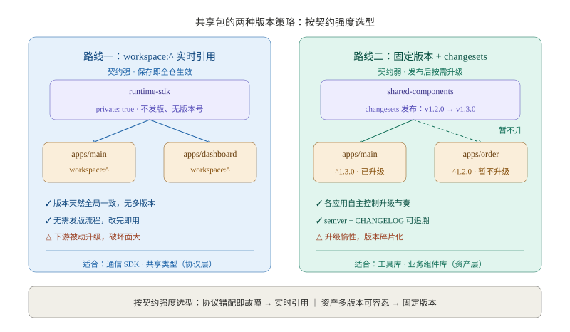

### 5.3 changesets：固定版本路线的自动化

选了固定版本路线，changesets 是当前社区的默认答案。它的工作流长这样：

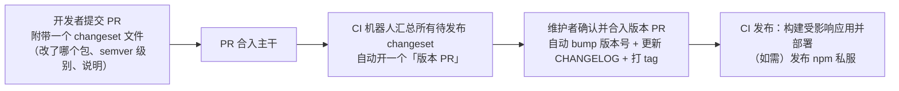

它的价值在于把「发布决策」从流程记忆变成仓库里的文件：变更说明跟着 PR 走，版本 PR 把所有待发变更聚合成一次可见的评审。对私有包（不对外发布），changesets 的 version 流程照常可用，只是跳过 publish——版本号和 CHANGELOG 照样生成，供追溯。

### 5.4 微前端特有的耦合：共享包与构建链

最后一个容易漏掉的点：当共享包被 MF `exposes` 的模块引用（第六篇）时，**提供方应用的构建必须先完成共享包的构建**。这正是第三节 turbo.json 里 `dependsOn: ["^build"]` 的用武之地——任务图会自动保证 `packages/shared-components` 先于 `apps/dashboard` 完成 build。分仓世界里这是「发布顺序编排」要人肉操心的事，同仓里变成任务图的一条边，这是 Monorepo 给 MF 联邦的隐性红利。

## 六、构建与缓存：只构建受影响的，复用一切可复用的

第二节说过，同仓方案的第一死因是 CI 全量构建。这一节给出解药的两个成分：**增量构建（算受影响）** 和 **远程缓存（复用历史）**。

### 6.1 增量构建：受依赖图驱动的「受影响」计算

Turborepo 根据 pnpm workspace 的依赖关系 + `dependsOn` 声明，自动推导出包级依赖图。「受影响」的计算就发生在这张图上：

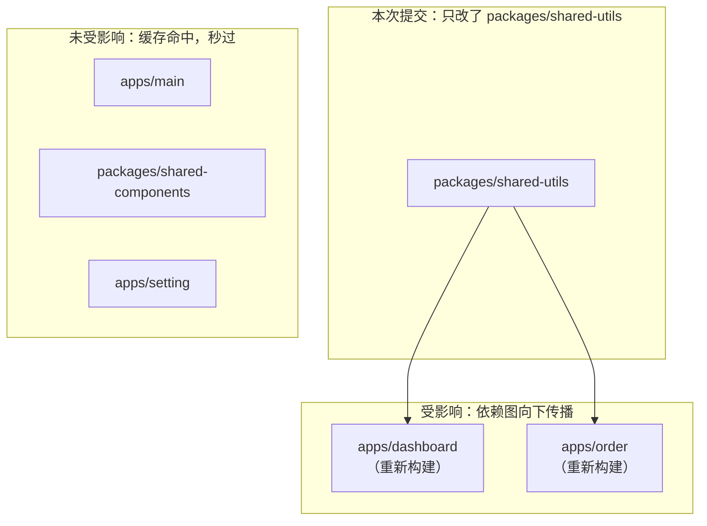

一次只改了一个工具包的提交，五个应用的 CI 从「全量等五分钟」变成「两个真实构建 + 三个缓存命中」。仓库越大，这个差距越是数量级的。

### 6.2 缓存的前提：把「任务的输入输出」说清楚

Turborepo 的缓存机制一句话：**对任务的全部输入（源文件内容 + 依赖包的产物 + 环境变量 + 全局配置）计算哈希，哈希相同就直接复用上次声明的 outputs**。这个定义里藏着两个工程要求：

1. **`outputs` 必须声明完整**。漏掉一个产物目录（比如忘了 `dist/**/*.map`），缓存命中时拿到的就是不完整产物——脏缓存是 Turborepo 事故榜第一名，症状是「代码明明改了，线上行为没变」；
2. **环境变量要显式纳入**。构建期注入的环境变量（接口地址、版本号）默认不在哈希输入里，要在 `turbo.json` 的 `globalEnv` 或任务的 `env` 字段里声明，否则换环境构建会命中错误缓存。

发布链路建议保守处理：构建产物直接上生产的任务，宁可 `--force` 或 `cache: false`，也不要拿「省一分钟」赌「发错包」。

### 6.3 远程缓存：让 CI 的构建成果惠及每个人

本地缓存只能复用自己机器的历史。远程缓存把产物放到共享存储，所有人和 CI 共用一份：

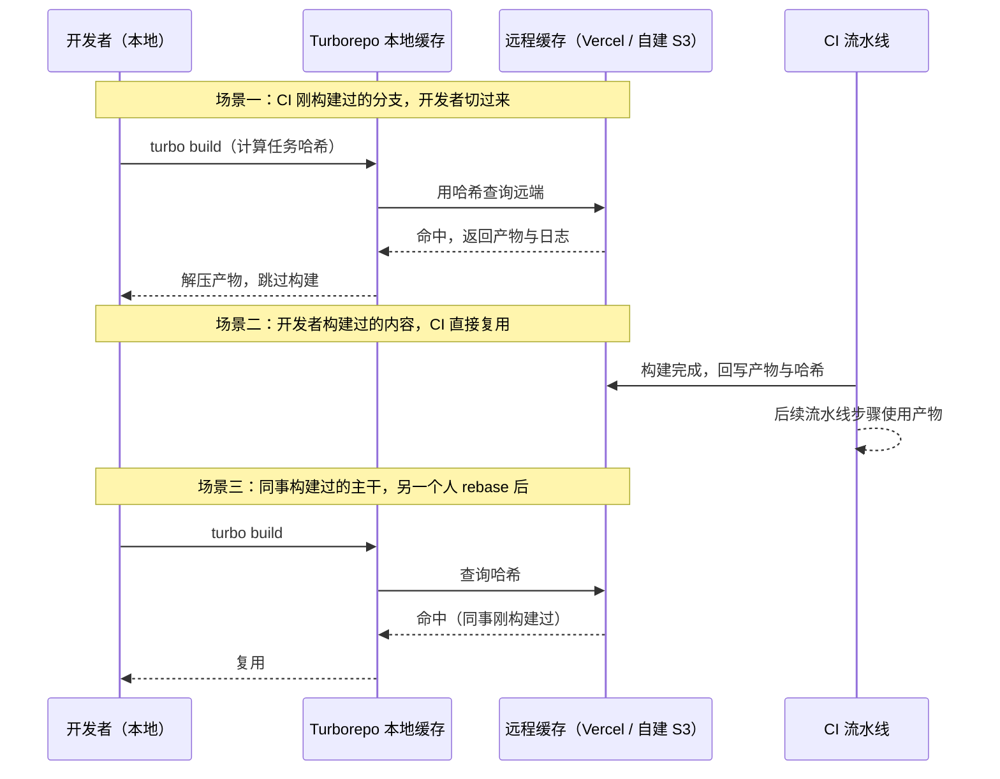

工程上的收益是双向的：开发者切分支、rebase 主干几乎不再等构建；CI 在 PR 流水线里只需构建真正变更的任务。自建方案（S3/MinIO + 社区实现的 remote cache API）适合内网合规要求，Vercel 托管方案适合开箱即用。开启成本很低，是「投入产出比最高的一档配置」。

### 6.4 产物与部署解耦：同仓不等于同部署

构建完成后的部署环节，再强调一次第一节的底线。五个 `apps/*` 的产物去向各自独立，Monorepo 只负责算清「这次提交影响了谁」：

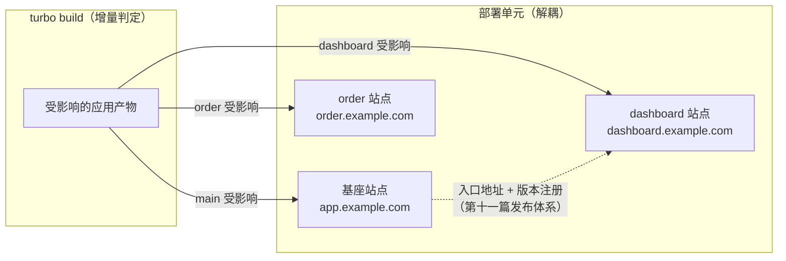

这套解耦和第十一篇的发布体系正好咬合：每个应用产物带版本化目录上传，基座侧（或配置中心）持有「子应用 → 入口地址 + 版本」的注册表，灰度与回滚都发生在注册表层面。Monorepo 的贡献是让「本次发版该传哪几个产物」变成增量构建的自动结论，而不是人工核对。

## 七、依赖治理：微前端让依赖问题从「构建警告」变成「运行时事故」

### 7.1 为什么微前端放大了依赖治理

单体应用里，依赖版本不对顶多是构建期警告或一次升级回归。微前端把多个应用装进同一个页面，**依赖不一致直接变成运行时冲突**：

- 两个子应用各带一份 React：hooks 报 `Invalid hook call`，跨应用状态天然分裂（第六篇 singleton 讨论）；
- 主子应用 antd 大版本不同：设计 token、弹层行为、样式变量集体漂移；
- 隐含单例假设的库（事件总线、弹层管理器）多实例并存：事件重复触发、弹层丢失（第六篇「隐式单例失效」坑）。

应对运行时冲突的三条路线，第六篇都铺过，这里从「仓库治理」视角重新对齐：

| 策略 | 机制 | 适用 | 对仓库治理的要求 |
| --- | --- | --- | --- |
| externals + 全局变量 | 子应用构建时不打公共依赖，运行时从 window 取 | qiankun 同栈、版本强统一 | 公共依赖版本必须全局唯一——catalogs 的主场 |
| MF shared 协商 | 运行时按 semver 协商版本（第六篇 4.1） | MF 同栈联邦 | 各应用 requiredVersion 与 lockfile 口径对齐，防幽灵升级 |
| 各带各的 | 每个子应用自带依赖副本 | 跨技术栈、高稳定优先 | 无强约束，但 singleton 假设的库要登记排查 |

注意：**Monorepo 不能替代任何一条运行时路线，但它给所有路线提供了「版本口径」的抓手**。分仓世界里「把 react 统一到 18.3」是 N 个仓库的升级马拉松；同仓里，它是一次 PR。

### 7.2 lockfile 管理口径：一个仓库，一份 lockfile

对本专栏讨论的单 workspace 同仓方案，推荐使用**根目录唯一 `pnpm-lock.yaml`**：所有应用与共享包的依赖解析结果集中在一处，任何影响依赖树的变更都会体现在 lockfile diff 里，可评审、可回滚。多 workspace、独立发布或刻意隔离依赖的仓库可能采用不同布局；CI 仍建议使用 `pnpm install --frozen-lockfile`，杜绝「CI 悄悄解析出与本地不同的依赖树」。

两个配套纪律：

- **lockfile 冲突的合并规则提前约定**：多分支并行改依赖是同仓高频冲突点。约定「lockfile 冲突一律放弃手动合并、以主干为准重装重生成」，比手工解冲突可靠得多；
- **升级类变更单独成 PR**：业务变更混着 lockfile 变更，回滚时业务和依赖拆不开——这是事故复盘里的经典悔恨。

### 7.3 幽灵依赖防治：pnpm 已经替你做了大半

第三节讲过 pnpm 严格 `node_modules` 的机制价值，这里落到治理动作：**代码里只允许 import `package.json` 显式声明过的包**。pnpm 的目录结构让违规直接报错，配合 lint（如 `import/no-extraneous-dependencies`）可以把「声明与使用一致」变成 CI 卡点。

微前端场景下这条纪律多一层含义：幽灵依赖意味着「应用真实依赖与声明不符」，那么 7.1 表格里的 externals 替换、shared 协商声明就都建立在错误的地基上——你以为子应用只带了自己的代码，实际上它还偷偷带着一份没人知道版本的 lodash。

### 7.4 统一升级流程：把「马拉松」变成「一次 PR」

把前面的抓手串成标准流程（以升级 react 为例，catalogs 承担版本口径）：

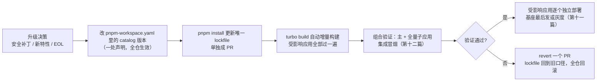

这条流程里有两个微前端特有的注意点：

- **组合验证不可省**：catalog 升级会让所有应用的新产物同时带新版本依赖。单应用测试全绿不代表组合 OK——「主应用 + 全量子应用」的集成冒烟（第十二篇）是这一步的质量闸门；
- **部署顺序有讲究**：走 externals 路线时基座是依赖提供方，**基座先发**（先就位全局变量）；走「各带各的」时顺序无关，但基座最后发可以让它在切换瞬间看到所有子应用的新形态，出问题好归因。

## 八、联调红利与边界：Monorepo 如何改写第十二篇的联调公式

第十二篇给过一套主子联调工程方案：本地代理映射线上 entry、子应用独立调试模式、fake 子应用桩。同仓之后，这套公式的参数变了。

**红利一：一条命令拉起主 + N 个子应用。** `turbo dev` 沿任务图并行启动各应用的 dev server，配合端口约定（main 3000、dashboard 3001……），联调环境从「各团队各自起服务再互相对地址」变成一条命令：

```json
// 根 package.json
{
  "scripts": {
    "dev": "turbo dev",
    "dev:main": "turbo dev --filter=@platform/main..."
  }
}
```

**红利二：通信 SDK 的改动实时可见。** `runtime-sdk` 是 `workspace:^` 直链，主应用侧改协议、子应用侧立即在 dev server 热更新里看到效果——第十二篇里「通信事件清单契约变更」的验证周期，从「发版联调」压缩到「保存刷新」。

**红利三：跨应用类型与跳转联查。** 主应用里「跳转到子应用订单详情」的工具函数、子应用暴露的 props 类型，都在同一仓库内可跳转、可重构。类型即文档、即契约，第十二篇说的 Schema 化校验又多了一层 TS 编译期的静态防线。

**边界也要说清**，否则红利会变成幻觉：

- **dev 直链是源码，生产消费的是产物**——本地联调通过不代表组合产物没问题（构建配置差异、依赖替换差异都发生在产物层），集成冒烟依然是不可省的闸门（第十二篇）；
- **「本地代理映射线上 entry」依然有价值**：子应用多到全量 `turbo dev` 太重时，只起主应用、其余子应用代理线上版本的策略照常适用——同仓给了你全量联调的能力，用不用全量由场景决定；
- **fake 子应用桩在同仓里更轻了**：桩直接做成 `packages/` 里的一个 dev-only 包，但它的存在意义没变——子应用未就绪时主应用先行开发。

一句话总结：**Monorepo 把第十二篇联调方案里「工程手段」的部分大幅简化了，但「契约与验证」的部分一分都不能少。**

## 九、落地路线：先 Monorepo 后微前端，按需推进

最后把全篇收进一条可执行的路线。核心判断在核心要点里已经给出：**先 Monorepo 后微前端是常见合理顺序**。理由是风险不对称的：

- Monorepo 化是**纯工程设施变更**：不动运行时，用户无感，收益（统一设施、增量构建）立刻兑现，可随时暂停；
- 微前端化是**运行时架构变更**：沙箱、样式、通信、路由全线受影响，必须有真实业务驱动（第二篇），失败了要退得回来。


图解：四个阶段的推进节奏画成堆叠横条——每条左侧是关键动作、右侧是退出标准，虚线框代表可选的阶段 4；注意阶段 2 到阶段 3 之间的性质分界：前面是工程设施变更，后面是运行时架构变更。

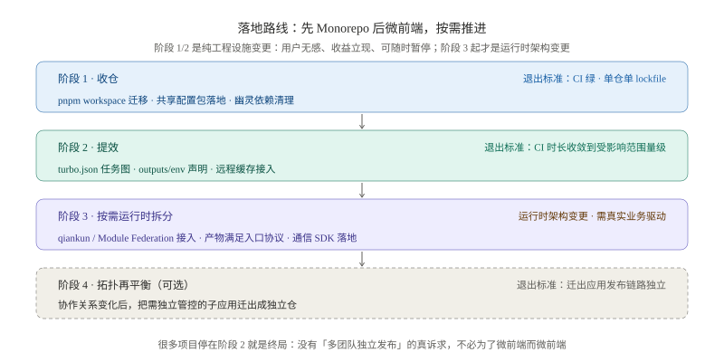

各阶段的关键动作与退出标准：

| 阶段 | 关键动作 | 退出标准 |
| --- | --- | --- |
| 1. 收仓 | workspace 迁移、共享配置包落地、唯一 lockfile、幽灵依赖清理 | CI 绿、单仓单 lockfile、lint/typecheck 全仓统一 |
| 2. 提效 | turbo.json 任务图、outputs/env 声明、远程缓存接入 | 任意提交的 CI 时长收敛到「受影响范围」量级 |
| 3. 运行时拆分 | 按第 3、14 篇选型接入；产物满足入口协议；通信 SDK 落地 | 独立部署跑通、灰度回滚演练通过（第十一篇） |
| 4. 再平衡 | 协作关系变化后，把需要独立管控的子应用迁出成独立仓 | 迁出应用的发布链路独立、共享包走私服版本化 |

三点提醒：

1. **阶段 4 不是失败**。康威定律下团队边界会变，仓库拓扑跟着变是常态，第四节决策树里的双向箭头就是这个意思；
2. **很多项目停在阶段 2 就是终局**。收仓提效之后如果没有「多团队独立发布」的真诉求，不必为了微前端而微前端——第十四篇的决策框架会正面回答这个问题；
3. **警惕阶段跳跃**。跳过阶段 1/2 直接做微前端的团队，后面几乎都会回头补工程设施这一课，只是那时补课的成本叠加了运行时复杂度。

最后附一张坑清单，收束全篇的实战注意点：

| 坑 | 典型现象 | 对策 |
| --- | --- | --- |
| 把 Monorepo 当微前端 | 目录拆了，发布仍整仓全量，「独立部署」从未发生 | 明确 `apps/*` 每包都是独立构建独立部署单元（第四节） |
| 过度工程 | 小团队三五个应用上 Rush 全家桶，工具维护成本反噬 | 从 pnpm workspace 起步，痛了再加编排层（第三节） |
| 脏缓存 | 改了代码，构建产物行为没变 | outputs/env 声明完整；发布链路 `--force`（6.2） |
| 协议包被动升级 | runtime-sdk 一行改动，全量子应用未验证就生效 | 协议变更走兼容期 + 版本握手（第八篇），CI 全量冒烟兜底 |
| 共享包改红全仓 | 一个 breaking 变更让五个应用同时构建失败 | 非协议包改固定版本渐进升级（第五节） |
| 循环依赖 | packages 互相引用，构建顺序死锁 | 分层约束：utils → components → sdk → apps，lint 卡环 |
| lockfile 合并地狱 | 多分支并行改依赖，pnpm-lock 冲突不断 | 锁文件冲突以主干为准重新生成；升级变更单独 PR（7.2） |
| workspace 包泄漏 | internal 包被误 publish 到外网 | `private: true` + 发布流程白名单 |
| 无增量构建硬上同仓 | 每次提交全量构建，CI 队列拥堵 | 同仓前先具备 turbo/Nx 能力（第二节决策树） |

## 十、小结

回看整篇，微前端与 Monorepo 的关系可以收束成三句话：

1. **定位上**，它们是正交的两层：Monorepo 管「构建期的共享与协作」，微前端管「运行时的隔离与编排」，同仓不等于微前端，微前端也不必同仓；衔接点只有一个——`apps/*` 的独立产物要满足微前端入口协议；
2. **工程上**，pnpm workspace + Turborepo + changesets 的默认组合，解决了同仓方案的全部关键命题：internal package 的版本策略按「契约强度」分类（协议包实时、资产包固定），增量构建与远程缓存守住 CI 体验，catalogs + 唯一 lockfile 让依赖统一从马拉松变成一次 PR；
3. **节奏上**，先 Monorepo 后微前端，按「收仓 → 提效 → 运行时拆分 → 拓扑再平衡」渐进推进；仓库边界对齐团队边界，且允许随组织演化再调整。

到这里，微前端的运行时体系（前十二篇）与仓库协作体系（本篇）都齐了。下一篇是这个专栏的收官：把散落在十四篇里的选型维度、决策树、落地路线收束成一张完整的架构决策地图，回答最初的那个问题——**你的团队到底要不要微前端，以及该怎么开始**：[第十四篇：微前端落地总结与架构决策](./14-architecture-decision.md)。
